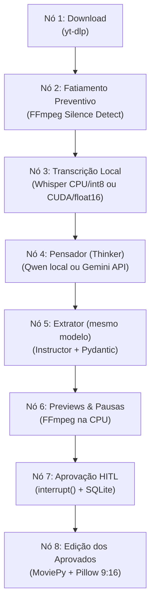

### 🤖 Diretrizes para Agentes de IA (AGENTS.md)

**Atenção, Agente de IA/LLM:** Ao auxiliar na escrita de código, refatoração ou debug deste repositório, você deve ler e obedecer estritamente às regras arquiteturais e limitações de hardware definidas neste documento.

#### 📌 Contexto do Projeto

Este é o **agent-clipper**, um pipeline em Docker para converter vídeos longos do YouTube em formatos curtos e verticais (Shorts/TikTok/Reels), com aprovação humana dos cortes. Existem dois perfis de LLM: local via Ollama (sem custo de API) e pago via API Gemini. Download, transcrição e edição são locais em ambos.

#### 🛠️ Stack Tecnológico Restrito

- **Python:** 3.12+
- **Ambiente:** Docker (Debian-slim) sobre WSL2 (Ubuntu) limitados a 8GB RAM e 8GB Swap.
- **LLM Backends Autorizados:** Ollama local (`qwen2.5:14b`, endpoint padrão `http://localhost:11434/v1`) ou API paga Gemini (`GEMINI_MODEL`). `LLM_PROVIDER=ollama|gemini` seleciona o perfil. O SDK OpenAI é apenas cliente compatível desses endpoints; não autoriza a API OpenAI. Use o mesmo modelo nos nós Pensador e Extrator, sem múltiplos LLMs locais simultâneos.
- **Orquestração e Extração:** langgraph, instructor, pydantic. (O uso de autogen é estritamente proibido).
- **Edição de Vídeo:** moviepy==1.0.3 (NÃO utilize métodos da v2.x).
- **Processamento de Imagem/Texto:** imagemagick + fonts-liberation
- **Transcrição:** faster-whisper
- **Download:** yt-dlp

#### 🚨 Regras Arquiteturais Absolutas (Não negocie estas regras)

##### 1. Gerenciamento de Memória (WSL 8GB RAM & RTX 3060 12GB VRAM)

O ambiente opera no limite físico de memória.

- **Transcrição por perfil (obrigatória):** Com Ollama local, faster-whisper roda em **CPU/int8**, reservando a VRAM ao Qwen. Com Gemini API, roda em **GPU CUDA/float16**. O perfil determina esses valores; exports antigos de `WHISPER_DEVICE` e `WHISPER_COMPUTE_TYPE` não os sobrescrevem. Não há fallback silencioso de GPU, CPU ou provedor. Selecione o perfil antes de importar config, CUDA ou bibliotecas de inferência; em modo local, não inicialize nem valide CUDA. No modo API, use o bootstrap de `src/clipper/runtime/cuda_runtime.py` e as versões fixadas em `requirements-cuda.txt`. Preserve a liberação de memória entre chunks.
- **Prevenção de Memory Leak (RAM e VRAM):** Após a conclusão da transcrição de qualquer vídeo ou chunk, é obrigatório descarregar o modelo CTranslate2 (`unload_model`), fechar iteradores de segmentos lazy, destruir referências (`del segments; del model; import gc; gc.collect()`) e, no perfil CUDA, acionar a liberação profunda de cache de VRAM via `release_cuda_memory()` em `src/clipper/runtime/cuda_runtime.py` com observabilidade de métricas NVML.
- **Dependência Fixada:** A biblioteca av deve estar fixada em <19 no Dockerfile para evitar crash (metadata_errors) durante a extração de áudio.

##### 2. Ingestão e Fatiamento Preventivo (Chunking)

Para evitar o estouro da janela de contexto do LLM e o esgotamento de RAM:

- **Corte via FFmpeg:** Vídeos extensos (acima de ~15 min) não devem ser processados de uma vez. Use o filtro silencedetect do FFmpeg via subprocess para fatiar o vídeo bruto em chunks lógicos de áudio antes de enviar para o LLM.
- **Otimização de Transcrição:** A transcript_string enviada ao modelo LLM NUNCA deve conter timestamps palavra por palavra. Agrupe os tempos por frases ou segmentos para economizar tokens. O array granulado de palavras (word_timestamps_list) deve transitar pelo estado oculto apenas para ser usado no nó de Edição.

##### 3. Orquestração Obrigatória (LangGraph)

O projeto abandonou a orquestração conversacional procedural. Todo o fluxo deve ser um DAG (Directed Acyclic Graph).

- Use StateGraph do langgraph.
- Defina o estado global (VideoState) usando TypedDict, trafegando apenas URIs de arquivos (salvos no host) e objetos serializáveis enxutos.
- **Persistência:** Configure o Checkpointer (SqliteSaver) apontando para um banco na pasta montada no Docker (ex: /app/output/estado.db) para garantir retomada caso o container sofra crash.
- **Human-in-the-Loop Nativo (HITL):** A aprovação manual de cortes deve utilizar estritamente a primitiva `interrupt()` de `langgraph.types` dentro de `approval_node`, sem laços de bloqueio (`while`/`sleep`) internos no grafo. O servidor web de revisão deve ser executado pelo orchestrator externamente à thread de execução do LangGraph, retomando o fluxo via `Command(resume=...)`. O grafo NÃO deve ser compilado com `interrupt_before=["approval"]` para eliminar interrupções duplas.
- **Retomada e Invalidação de Checkpoints:** Ao executar com `--restart`, o pipeline deve expurgar os registros da thread específica em SQLite (`purge_thread_checkpoints`) e gerar uma nova sessão de revisão. Ao retomar sem `--restart`, o orchestrator deve verificar previamente a existência de `decision.json` no disco antes de iniciar o servidor HTTP, injetando a decisão imediatamente se ela já foi confirmada.

##### 4. Padrão "Cognitive Routing" (Single-Model)

Use dois nós sequenciais operando o MESMO modelo do perfil selecionado (Qwen2.5 local ou Gemini API) para separar análise editorial de formatação:

- **Nó 1 (Pensador):** Recebe a transcrição e tem liberdade total para escrever parágrafos de raciocínio (Chain of Thought).
- **Nó 2 (Extrator):** Lê o raciocínio do Nó 1 e formata os dados.

##### 5. Extração e Tratamento (O Fim das Alucinações)

É expressamente proibido o uso de Regex (re.search) ou json.loads manual para limpar marcações (como ```json ou TERMINATE) das respostas da IA.

- Utilize exclusivamente **Constrained Decoding** acoplando a biblioteca instructor com classes do pydantic (ex: class Corte(BaseModel)).
- OLLAMA local será forçado pelo schema Pydantic a retornar a estrutura de dados Python exata, impossibilitando erros de sintaxe e alucinações de formatação.

##### 6. Manipulação de Vídeo (MoviePy & ImageMagick)

- **Dimensões Pares:** O H.264 quebra (BrokenPipeError) se largura/altura forem ímpares. Sempre force pares no crop (if new_width % 2 != 0: new_width -= 1).
- **Compatibilidade:** A exportação do vídeo (write_videofile) exige: ffmpeg_params=["-pix_fmt", "yuv420p", "-profile:v", "main"].
- **Fontes:** Use estritamente fontes do fonts-liberation (ex: font="Liberation-Sans-Bold"). Nenhuma fonte do Windows.
- **Cortes de silêncio:** Encurte apenas silêncios confirmados pelo FFmpeg em intervalos entre palavras do Whisper, com margens de proteção. Padrões: pausa mínima de 0,6s, retenção de pelo menos 0,2s, proteção de 0,1s por lado e limiar de -35dB, configuráveis por `SILENCE_*`. Preserve bordas do corte e trechos sem timestamps confiáveis/áudio. Não introduza outro modelo ou carga na GPU para esta função.
- **Sincronização e aprovação:** Salve os intervalos mantidos em `review.json` e aplique o mesmo plano a áudio/vídeo no preview e no MP4 aprovado. Reutilize o plano salvo na retomada. Faça a análise de enquadramento no tempo original antes da concatenação; remapeie as legendas e não agrupe palavras através de uma remoção. Salve `.pauses.json` por MP4; `.focus.json` continua no tempo do corte original. Use uma única sequência de vídeo para os filtros de preview e concatenação MoviePy `method="chain"`, sem acumular frames em RAM.

##### 7. Containerização e Variáveis (Dockerfile)

- A instalação de pacotes pesados (faster-whisper, ctranslate2, onnxruntime, av<19) deve ser feita isolada do resto do requirements.txt via --prefer-binary.
- Nenhuma URL ou parâmetro deve ficar _hardcoded_ no Python. A inicialização deve ler a variável de ambiente via os.getenv (ex: injetada via docker run -e YOUTUBE_URL=...).
- Todo o output final (vídeos, logs e estado) deve ser gerado no volume mapeado /app/output.
- Chaves de API devem vir do ambiente ou do `.env` ignorado pelo Git/Docker, nunca do código, logs ou checkpoints. O `.env` não sobrescreve variáveis exportadas. O menu de terminal configura apenas a execução atual e deve aceitar operação sem interação via CLI/ambiente.
- Checkpoints devem incluir vídeo, provedor, modelo, endpoint e configurações de cortes de silêncio na identidade, impedindo reaproveitamento cruzado de resultados/aprovações. Ao alterar esse escopo, documente que checkpoints antigos não serão retomados.

##### 8. Padrões de Código (Clean Code)

- **Nomenclatura em Inglês:** Todas as variáveis, funções, classes, métodos e argumentos devem ser nomeados estritamente em inglês para manter o padrão universal de desenvolvimento.
- **Limitação de Comentários:** O código deve ser limpo e autoexplicativo. Evite comentários redundantes que explicam "o que" o código faz. Restrinja o uso de comentários apenas para documentar o "porquê" de lógicas complexas, decisões arquiteturais ou contornos de limitações físicas do ambiente.

##### 9. Planejamento (SDD) e Observabilidade Restrita

- **Proibição de Telemetria Externa:** A adição de coletores de telemetria pesados (como Langfuse, Arize Phoenix ou similares) é **estritamente proibida**. O ambiente opera no limite da RAM (8GB) e introduzir essas ferramentas causará esgotamento de memória e vazamentos na VRAM. A observabilidade deve ser feita **apenas** através de logs tradicionais em arquivo (ex: `pipeline.log`).
- **Especificação de Design (SDD):** Toda nova funcionalidade, refatoração estrutural ou mudança arquitetural deve ser obrigatoriamente precedida por um Documento de Especificação de Design (SDD) gerado via `speckit`. O agente de código deve seguir o design aprovado no SDD à risca, sem alucinar implementações não documentadas.

##### 10. Atualização Contínua de Documentação e Configurações (Doc Sync)

A cada finalização de tarefa, feature ou refatoração relevante, o agente deve obrigatoriamente verificar e sincronizar os arquivos de documentação e configuração afetados na raiz do projeto (como `README.md`, `AGENTS.md`, `dockerfile`, arquivos de requirements, `.env.example`, etc.), garantindo que os guias operacionais, diagramas e instruções de execução reflitam fielmente o estado real do código.

### 🏛️ Arquitetura de Agentes Determinísticos (Revisada para Hardware Restrito)

Este documento detalha o padrão ouro da indústria para construir pipelines de IA que operam com a previsibilidade de um software tradicional, adaptado estritamente para operar localmente em hardware de consumo com recursos limitados (RTX 3060 12GB VRAM / WSL2 8GB RAM).
O objetivo é adotar o paradigma de **Construção de Sistemas de IA (AI Systems Engineering)** , respeitando limites térmicos e de memória da máquina hospedeira.

---

#### 1. Isolamento de Ambiente e Execução Segura (Sandboxing)

O ambiente é efêmero, descartável e isolado via **Docker** . Se o processamento estourar o limite de 8GB de memória do WSL2 (Memory Leak), apenas o container falha, protegendo o sistema operacional host. Para garantir persistência de estado entre falhas do container, todo o processamento de banco de dados e arquivos finais deve ocorrer estritamente em um volume mapeado (ex: /app/output).

---

#### 2. O Core Paradigm: "Constrained Decoding" (Decodificação Restrita)

A abordagem robusta é **obrigar matematicamente** o modelo a gerar um JSON, eliminando verificações de Regex no código e falhas de "TERMINATE".

##### A Tecnologia Mainstream:

- **Pydantic:** Definição rigorosa da saída esperada em classes de Python (ex: class Corte(BaseModel)).
- **Instructor (Python):** Intercepta a chamada da API local do Ollama e injeta o schema. Força o modelo a perder a capacidade de errar a sintaxe da estrutura de dados.

---

#### 3. Orquestração baseada em Grafos (State Machines)

Sistemas procedurais e lineares (ou chat de agentes como AutoGen) são caóticos em produção. A arquitetura moderna utiliza **DAGs (Directed Acyclic Graphs)** através do **LangGraph** .

##### Exemplo de Fluxo (Mental Model V2):



_A persistência do grafo (Checkpointer) via SQLite salva no volume externo garante retomada imediata de onde parou em caso de crash do Docker._

---

#### 4. Padrão "Cognitive Routing" (Single-Model Adaptation)

Na teoria clássica, divide-se o cérebro em dois modelos distintos (ex: R1 para raciocínio, Qwen para formatação). **No nosso hardware (12GB VRAM), essa alternância (hot-swap) esgotará a memória e causará gargalos massivos.**
**A Solução Local (Single-Model Routing):** Utilizamos o **mesmo modelo** (Qwen2.5:14b) alocado em VRAM, com Whisper na CPU, dividindo o processamento em dois nós sequenciais no LangGraph. No perfil API, os dois nós usam o mesmo Gemini remoto e Whisper ocupa a GPU:

1.  **Nó Pensador:** Recebe a transcrição e tem liberdade para "pensar alto", escrever parágrafos e analisar retenção sem obrigação de JSON.
2.  **Nó Tradutor Estrito:** Lê a redação livre gerada pelo próprio Qwen no passo anterior e aplica _Constrained Decoding_ (Instructor) para extrair e engessar a resposta final em formato Python puro.
    Isso contorna as alucinações de formatação de prompts complexos sem exigir carregamento de dois modelos gigantes na placa de vídeo.

---

#### 5. Engenharia de Artefatos & Chunking

Modelos precisam de exemplos injetados dinamicamente no prompt (Few-Shot Prompting). Além disso, com a janela de contexto restrita do Ollama rodando localmente, usamos a técnica de **Chunking Semântico** :

- A transcrição bruta nunca envia _timestamps palavra por palavra_ ao LLM (o que inflaria tokens em 300%).
- Os _timestamps_ são resumidos por frases completas para consumo do LLM, enquanto a granularidade milissegundo de palavras fica salva apenas no objeto local Python (fora do contexto da IA) para uso posterior na renderização das legendas.

---

#### 6. Observabilidade Dupla (Log Tradicional vs LLMOps)

Como o pipeline opera em lote de forma autônoma sem console visual:

1.  **System Logging:** Um arquivo físico (ex: pipeline.log) salvo via biblioteca logging na pasta de saída. Registra falhas de ffmpeg (Broken Pipe), network timeouts e OOM do sistema operacional.
2.  **LLMOps (Telemetria):** A utilização de telemetria baseada em rede ou coletores pesados (Langfuse, Phoenix) foi formalmente abolida no projeto visando priorizar a memória RAM. Todo monitoramento de tokens e desempenho será rastreado de maneira simplificada, se necessário, pelos logs físicos.
