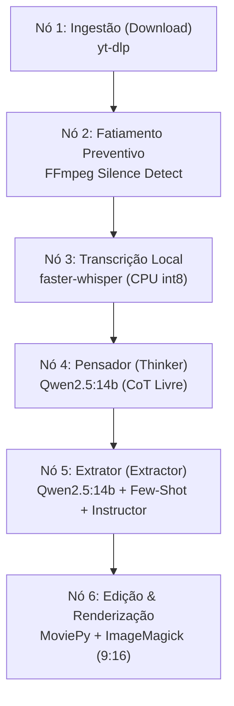

# Agent Clipper 🎬🤖

Um pipeline 100% autônomo, local, de custo zero e isolado em container (Docker) para ingestão de vídeos do YouTube e conversão inteligente para formatos curtos verticais (YouTube Shorts / TikTok / Reels).

O sistema adota os princípios de **AI Systems Engineering**: abandona chat procedurais caóticos em favor de fluxos determinísticos baseados em grafos direcionados (**LangGraph**), decodificação restrita (**Constrained Decoding**) e **Cognitive Routing** de modelo único.

---

## 🏛️ Arquitetura do Pipeline (LangGraph DAG)

O pipeline opera como um Grafo Acíclico Dirigido (DAG) de 6 nós sequenciais com persistência de estado via SQLite (`SqliteSaver`), garantindo retomada imediata em caso de falhas:



### Destaques Arquiteturais

1. **Cognitive Routing (Single-Model)**: Utiliza uma única instância do **Qwen2.5:14b** alocada em VRAM (RTX 3060 12GB), dividida em dois papéis cognitivos complementares:
   - **Nó Pensador (`thinker_node`)**: Analisa a transcrição agrupada com liberdade criativa total (_Chain of Thought_) para identificar ganchos de retenção e momentos virais.
   - **Nó Extrator (`extractor_node`)**: Lê a transcrição e o raciocínio estratégico, ancorado por exemplos Few-Shot multi-turno e **Constrained Decoding** (Instructor + Pydantic), garantindo 100% de conformidade com o schema `CorteVideo` sem alucinações de formatação e sem regex.
2. **Centralização de Prompts (`prompts.py`)**: Todos os artefatos de prompt e exemplos Few-Shot residem isolados em `prompts.py`, desacoplados da lógica de orquestração do grafo.
3. **Gerenciamento Estrito de Memória (WSL 8GB RAM / 12GB VRAM)**:
   - O `faster-whisper` roda exclusivamente na CPU (`device="cpu"`, `compute_type="int8"`), reservando a VRAM para o LLM.
   - Fatiamento preventivo de áudio via FFmpeg em pausas silenciosas (`node_0.py`) para evitar estouro de contexto e esgotamento de memória.
   - Coleta de lixo forçada (`gc.collect()`) após processamento de chunks.
4. **Resiliência e Persistência**: Grafo compilado com `SqliteSaver` gravando checkpoints em `/app/output/estado.db`.

---

## 🛠️ Stack Tecnológico

- **Orquestração:** LangGraph (`StateGraph`, `SqliteSaver`)
- **LLM Backend:** Ollama (`qwen2.5:14b`) via endpoint local OpenAI-compatible
- **Decodificação Estruturada:** Instructor, Pydantic v2
- **Download:** yt-dlp
- **Fatiamento & Áudio:** FFmpeg (`silencedetect`), PyAV (`av<19`)
- **Transcrição:** faster-whisper, ctranslate2
- **Edição & Renderização:** MoviePy (v1.0.3), ImageMagick, fonts-liberation
- **Ambiente & Container:** Docker (Debian-slim), WSL2 (Ubuntu)

---

## 📂 Estrutura do Projeto

```text
agent-clipper/
├── orchestrator.py      # DAG LangGraph (download -> fatiamento -> transcricao -> pensador -> extrator -> editor)
├── prompts.py           # Templates de prompt imutáveis e exemplos Few-Shot multi-turno
├── schemas.py           # Modelos Pydantic (CorteVideo, CortesResponse)
├── config.py            # Configurações centralizadas e variáveis de ambiente
├── node_0.py            # Fatiamento preventivo de áudio baseado em silêncio
├── ingestion.py         # Download via yt-dlp e transcrição via faster-whisper
├── editor.py            # Renderização vertical (9:16), corte e legendas dinâmicas
├── dockerfile           # Ambiente isolado com dependências pré-compiladas
├── requirements.txt     # Dependências Python pinadas
└── specs/               # Especificações, planos, tarefas e relatórios SDD (Speckit)
```

---

## 🛑 Pré-requisitos

1. **Docker Desktop** (com integração WSL2 habilitada no Windows).
2. **Ollama**: Instalado e rodando localmente na máquina host.
   - Baixe e disponibilize o modelo executando:
     ```bash
     ollama run qwen2.5:14b
     ```

---

## ⚠️ Configuração Obrigatória do WSL2 (Windows)

Para que o container Docker acesse a API do Ollama na porta `11434` da máquina host via localhost e para respeitar os limites físicos de hardware:

1. No Windows, edite ou crie o arquivo `C:\Users\<SeuUsuario>\.wslconfig`.
2. Adicione a configuração:
   ```ini
   [wsl2]
   networkingMode=mirrored
   memory=8GB
   swap=8GB
   ```
3. Reinicie o WSL pelo PowerShell:
   ```powershell
   wsl --shutdown
   ```

---

## 🚀 Como Usar com Docker (Recomendado)

O isolamento em container garante que todas as dependências do sistema operacional (`ffmpeg`, `imagemagick`, `fonts-liberation`, bibliotecas C) fiquem encapsuladas.

### 1. Construir a imagem Docker

```bash
docker build -t agent-clipper .
```

### 2. Executar o container

Passe a URL do vídeo desejado via variável `YOUTUBE_URL` e monte a pasta `./output` para salvar os vídeos gerados:

```bash
docker run --rm --network host \
  -e YOUTUBE_URL="https://www.youtube.com/watch?v=SEU_LINK_AQUI" \
  -v $(pwd)/output:/app/output \
  agent-clipper
```

Os vídeos Shorts (verticais 9:16 com legendas) serão gerados diretamente em `./output/`.

---

## ⚙️ Execução Local sem Docker (Desenvolvimento)

Caso queira executar diretamente no ambiente host WSL2/Linux:

1. **Instalar dependências de sistema:**

   ```bash
   sudo apt update && sudo apt install -y ffmpeg libgomp1 nodejs imagemagick fonts-liberation fontconfig
   ```

2. **Criar e ativar o ambiente virtual Python:**

   ```bash
   python3 -m venv venv
   source venv/bin/activate
   ```

3. **Instalar dependências Python:**

   ```bash
   pip install --prefer-binary -r requirements.txt
   ```

4. **Executar o pipeline:**
   ```bash
   YOUTUBE_URL="https://www.youtube.com/watch?v=SEU_LINK_AQUI" python orchestrator.py
   ```

---

## 🛠️ Variáveis de Ambiente Suportadas

Todas as configurações possuem valores padrão defensivos definidos em [`config.py`](file:///home/davig/agents-workspace/agent-clipper/config.py):

| Variável          | Padrão                      | Descrição                                     |
| ----------------- | --------------------------- | --------------------------------------------- |
| `YOUTUBE_URL`     | _Obrigatória_               | Link do vídeo do YouTube a ser processado     |
| `OUTPUT_DIR`      | `/app/output` ou `output`   | Diretório de destino de vídeos, logs e estado |
| `DOWNLOADS_DIR`   | `<OUTPUT_DIR>/downloads`    | Diretório temporário dos vídeos baixados      |
| `DB_PATH`         | `<OUTPUT_DIR>/estado.db`    | Banco SQLite para persistência do LangGraph   |
| `LOG_FILE`        | `<OUTPUT_DIR>/pipeline.log` | Arquivo físico de logs do sistema             |
| `OLLAMA_BASE_URL` | `http://127.0.0.1:11434/v1` | Endpoint da API OpenAI-compatible do Ollama   |
| `OLLAMA_MODEL`    | `qwen2.5:14b`               | Modelo local utilizado no Thinker e Extractor |
