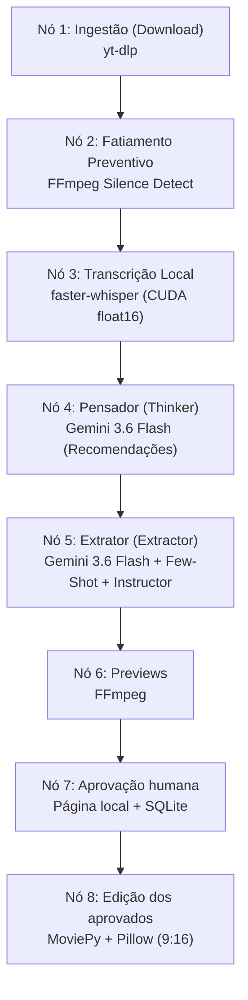

# Agent Clipper 🎬🤖

Um pipeline com aprovação humana dos cortes, LLM via API Gemini e processamento de mídia local e isolado em container (Docker) para ingestão de vídeos do YouTube e conversão inteligente para formatos curtos verticais (YouTube Shorts / TikTok / Reels).

O sistema adota os princípios de **AI Systems Engineering**: abandona chat procedurais caóticos em favor de fluxos determinísticos baseados em grafos direcionados (**LangGraph**), decodificação restrita (**Constrained Decoding**) e **Cognitive Routing** de modelo único.

---

## 🏛️ Arquitetura do Pipeline (LangGraph DAG)

O pipeline opera como um Grafo Acíclico Dirigido (DAG) de 8 nós sequenciais com persistência de estado via SQLite (`SqliteSaver`), garantindo retomada imediata em caso de falhas:



### Destaques Arquiteturais

1. **Cognitive Routing (Single-Model)**: Utiliza o modelo **gemini-3.6-flash** via API Gemini, dividida em dois papéis cognitivos complementares:
   - **Nó Pensador (`thinker_node`)**: Analisa a transcrição agrupada para produzir recomendações editoriais concisas para identificar ganchos de retenção e momentos virais.
   - **Nó Extrator (`extractor_node`)**: Lê a transcrição e o raciocínio estratégico, ancorado por exemplos Few-Shot multi-turno e **Constrained Decoding** (Instructor + Pydantic), garantindo 100% de conformidade com o schema `CorteVideo` sem alucinações de formatação e sem regex.
2. **Centralização de Prompts (`prompts.py`)**: Todos os artefatos de prompt e exemplos Few-Shot residem isolados em `prompts.py`, desacoplados da lógica de orquestração do grafo.
3. **Gerenciamento Estrito de Memória (WSL 8GB RAM / 12GB VRAM)**:
   - O `faster-whisper` roda na GPU (`device="cuda"`, `compute_type="float16"`). A LLM permanece na API Gemini, sem disputar VRAM.
   - Fatiamento preventivo de áudio via FFmpeg em pausas silenciosas (`node_0.py`) para evitar estouro de contexto e esgotamento de memória.
   - Coleta de lixo forçada (`gc.collect()`) após processamento de chunks.
4. **Resiliência e Persistência**: Grafo compilado com `SqliteSaver` gravando checkpoints em `/app/output/estado.db`.

---

## 🛠️ Stack Tecnológico

- **Orquestração:** LangGraph (`StateGraph`, `SqliteSaver`)
- **LLM Backend:** Gemini API (`gemini-3.6-flash`) via Chat Completions
- **Decodificação Estruturada:** Instructor, Pydantic v2
- **Download:** yt-dlp
- **Fatiamento & Áudio:** FFmpeg (`silencedetect`), PyAV (`av<19`)
- **Transcrição:** faster-whisper, ctranslate2
- **Edição & Renderização:** MoviePy (v1.0.3), Pillow, fonts-liberation
- **Ambiente & Container:** Docker (Debian-slim), WSL2 (Ubuntu)

---

## 📂 Estrutura do Projeto

```text
agent-clipper/
├── orchestrator.py      # DAG LangGraph (download -> fatiamento -> transcricao -> pensador -> extrator -> editor)
├── prompts.py           # Templates de prompt imutáveis e exemplos Few-Shot multi-turno
├── schemas.py           # Modelos Pydantic (CorteVideo, CortesResponse)
├── config.py            # Configurações centralizadas e variáveis de ambiente
├── node_0.py            # Fatiamento preventivo de áudio baseado em silêncio
├── ingestion.py         # Download via yt-dlp e transcrição via faster-whisper
├── editor.py            # Renderização vertical (9:16), corte e legendas com Pillow
├── dockerfile           # Ambiente isolado com dependências pré-compiladas
├── requirements.txt     # Dependências Python pinadas
└── specs/               # Especificações, planos, tarefas e relatórios SDD (Speckit)
```

---

## 🛑 Pré-requisitos

1. **Docker Desktop** (com integração WSL2 habilitada no Windows).
2. **API Gemini**: chave do Google AI Studio com acesso ao modelo configurado. Em `config.py`, substitua `GEMINI_API_KEY = "COLE_SUA_API_KEY_AQUI"` pela sua chave.

A API está sujeita às cotas e à cobrança do plano contratado e recebe os textos das transcrições e as recomendações editoriais. Download, transcrição na GPU e edição continuam locais. Ollama e GPU para LLM não são necessários.

---

## 🚀 Como Usar com Docker (Recomendado)

O isolamento em container garante que todas as dependências do sistema operacional (`ffmpeg`, `imagemagick`, `fonts-liberation`, bibliotecas C) fiquem encapsuladas.

### 1. Construir a imagem Docker

```bash
docker build -t agent-clipper .
```

### 2. Executar o container

Preencha `GEMINI_API_KEY` diretamente em `config.py` e copie `.env.example` para `.env`. Depois, passe a URL do vídeo desejado via variável `YOUTUBE_URL` e monte a pasta `./output` para salvar os vídeos gerados:

```bash
docker run --rm --env-file .env \
  -e YOUTUBE_URL="https://www.youtube.com/watch?v=SEU_LINK_AQUI" \
  -v $(pwd)/output:/app/output \
  agent-clipper
```

Os vídeos Shorts (verticais 9:16 com legendas) serão gerados diretamente em `./output/`.

---

## ⚙️ Execução Local sem Docker (Desenvolvimento)

Caso queira executar diretamente no ambiente host WSL2/Linux:

1. **Instalar dependências de sistema:**

   ```bash
   sudo apt update && sudo apt install -y ffmpeg libgomp1 nodejs imagemagick fonts-liberation fontconfig
   ```

2. **Criar e ativar o ambiente virtual Python:**

   ```bash
   python3 -m venv venv
   source venv/bin/activate
   ```

3. **Instalar dependências Python:**

   ```bash
   pip install --prefer-binary -r requirements.txt
   ```

4. **Executar o pipeline:**
   ```bash
   YOUTUBE_URL="https://www.youtube.com/watch?v=SEU_LINK_AQUI" python orchestrator.py
   ```

---

## 🛠️ Variáveis de Ambiente Suportadas

Todas as configurações possuem valores padrão defensivos definidos em [`config.py`](config.py):

| Variável          | Padrão                      | Descrição                                     |
| ----------------- | --------------------------- | --------------------------------------------- |
| `YOUTUBE_URL`     | _Obrigatória_               | Link do vídeo do YouTube a ser processado     |
| `OUTPUT_DIR`      | `/app/output` ou `output`   | Diretório de destino de vídeos, logs e estado |
| `DOWNLOADS_DIR`   | `<OUTPUT_DIR>/downloads`    | Diretório temporário dos vídeos baixados      |
| `DB_PATH`         | `<OUTPUT_DIR>/estado.db`    | Banco SQLite para persistência do LangGraph   |
| `LOG_FILE`        | `<OUTPUT_DIR>/pipeline.log` | Arquivo físico de logs do sistema             |
| `GEMINI_API_KEY` (em `config.py`) | _Obrigatória_ | Chave preenchida diretamente no código |
| `GEMINI_BASE_URL` | `https://generativelanguage.googleapis.com/v1beta/openai/` | Endpoint Gemini compatível com o SDK OpenAI |
| `GEMINI_MODEL` | `gemini-3.6-flash` | Modelo usado nos dois nós |
| `LLM_MAX_COMPLETION_TOKENS` | `8192` | Limite por chamada, incluindo tokens de raciocínio |

O Python lê as variáveis do processo; não carrega `.env` automaticamente. No Docker, use `--env-file .env`. No PowerShell, configure `$env:YOUTUBE_URL="..."` antes de executar `python orchestrator.py`.

O pacote `openai` permanece como cliente HTTP compatível, conforme a [documentação do Google](https://ai.google.dev/gemini-api/docs/openai); as chamadas são enviadas ao Gemini, usando a chave do Google. A chave preenchida em `config.py` não deve ser incluída em commits ou imagens Docker compartilhadas.

As legendas são renderizadas com Pillow e a fonte Liberation Sans Bold, localizada via `fc-match` (fontconfig). Isso evita o bloqueio de leitura `@/tmp` do ImageMagick ao executar na venv. Não é necessário editar `policy.xml`. Após atualizar, execute `pip install --prefer-binary -r requirements.txt` na venv.

### Transcrição na GPU (venv no WSL/Linux)

O padrão é CUDA com float16, mantendo o modelo Whisper small. A instância e o iterador de segmentos são liberados após cada chunk, inclusive em caso de erro. O driver NVIDIA do host precisa disponibilizar a GPU no WSL (`nvidia-smi`). CTranslate2 requer cuBLAS CUDA 12 e cuDNN 9, conforme a [documentação do faster-whisper](https://github.com/SYSTRAN/faster-whisper#gpu).

```bash
source venv/bin/activate
pip install --prefer-binary -r requirements-gpu.txt
export YOUTUBE_URL="https://www.youtube.com/watch?v=SEU_VIDEO"
bash run_pipeline.sh
```

O script usa `venv/bin/python` e configura `LD_LIBRARY_PATH` com as bibliotecas NVIDIA instaladas na venv. Se usar outra venv, passe `PYTHON_BIN=/caminho/da/venv/bin/python`. Para executar `python orchestrator.py` diretamente, disponibilize essas bibliotecas no `LD_LIBRARY_PATH` antes de iniciar o Python.

`WHISPER_DEVICE` (padrão `cuda`) e `WHISPER_COMPUTE_TYPE` (padrão `float16`) podem ser configurados pelo ambiente. A configuração de CPU requer ambos: `WHISPER_DEVICE=cpu WHISPER_COMPUTE_TYPE=int8`. Falhas CUDA são reportadas; não há troca automática para CPU.

A imagem Docker atual não inclui o runtime CUDA. As instruções acima destinam-se à venv WSL/Linux.
## Revisão e aprovação antes da edição

Execute normalmente com `bash run_pipeline.sh`. Depois da extração, o pipeline gera previews leves dos trechos originais e mostra no terminal:

```text
Revise e aprove os cortes no navegador: http://127.0.0.1:8765/
```

Abra o endereço no navegador do Windows/WSL. Cada cartão contém o vídeo do trecho, título, breve descrição do tema, intervalo no original e duração. Marque os cortes desejados e clique em **Confirmar seleção e editar**. Nenhum vem pré-selecionado. **Rejeitar todos** encerra o processamento sem gerar vídeos finais. Os previews têm resolução reduzida e não contêm o corte vertical nem as legendas finais.

A página só é servida enquanto a revisão está pendente; após confirmar, a edição continua no terminal. O serviço escuta apenas em localhost. Previews, metadados e decisões ficam em `output/reviews/<identificador>/`. Não há dependência de um serviço web externo.

Você pode pressionar **Ctrl+C** enquanto aguarda e executar o mesmo comando, com a mesma `YOUTUBE_URL`, para retomar o checkpoint pendente sem repetir as etapas anteriores. Se a decisão já tiver sido enviada, ela será reaproveitada. Para processar novamente um vídeo já concluído, criando uma nova revisão:

```bash
bash run_pipeline.sh orchestrator.py --restart
```

Se a porta estiver ocupada:

```bash
bash run_pipeline.sh orchestrator.py --review-port 8766
```

O fluxo de aprovação usa um novo identificador de checkpoint para impedir que execuções antigas, sem aprovação humana, pulem a revisão. Na primeira execução após esta atualização, checkpoints do fluxo antigo não são reutilizados. Essas instruções de acesso à página são para a venv no WSL/Linux; o container requer encaminhamento de rede compatível com o serviço em localhost.