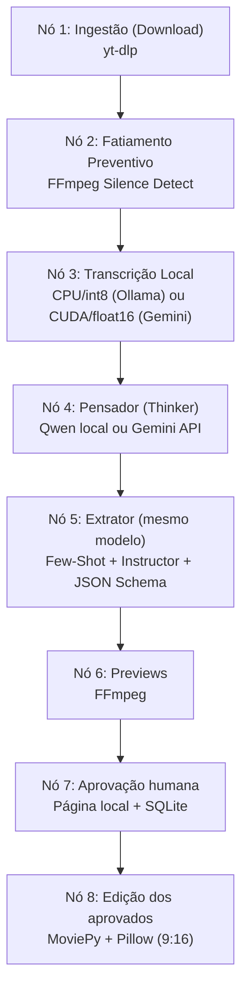

# Agent Clipper 🎬🤖

Um pipeline com aprovação humana dos cortes, LLM local via Ollama ou via API paga Gemini e processamento de mídia local em Docker para converter vídeos do YouTube em formatos curtos verticais (YouTube Shorts / TikTok / Reels).

| Perfil (`LLM_PROVIDER`) | LLM | faster-whisper |
| --- | --- | --- |
| `ollama` | Qwen2.5:14b local, usando a VRAM | CPU / int8 |
| `gemini` | Modelo configurado na API paga Gemini | GPU CUDA / float16 |

Execute `python orchestrator.py` ou `bash run_pipeline.sh` em um terminal para escolher o perfil, modelo e URL. Enter aceita o padrão exibido. O menu aparece antes de inicializar CUDA; a chave Gemini, quando ausente, é solicitada sem eco. As escolhas valem para a execução atual; edite `.env` para mudar os padrões. O menu não grava credenciais.

Sem perguntas, use `--provider ollama` ou `--provider gemini`; também existem `--model`, `--url` e `--non-interactive`. Sem terminal interativo, o script usa CLI/ambiente automaticamente:

```bash
bash run_pipeline.sh --provider ollama --url "https://www.youtube.com/watch?v=SEU_VIDEO"
bash run_pipeline.sh --provider gemini --model gemini-3.6-flash --url "https://www.youtube.com/watch?v=SEU_VIDEO"
python orchestrator.py --non-interactive --restart
```

O sistema adota os princípios de **AI Systems Engineering**: abandona chat procedurais caóticos em favor de fluxos determinísticos baseados em grafos direcionados (**LangGraph**), decodificação restrita (**Constrained Decoding**) e **Cognitive Routing** de modelo único.

---

## 🏛️ Arquitetura do Pipeline (LangGraph DAG)

O pipeline opera como um Grafo Acíclico Dirigido (DAG) de 8 nós sequenciais com persistência de estado via SQLite (`SqliteSaver`), garantindo retomada imediata em caso de falhas:



### Destaques Arquiteturais

1. **Cognitive Routing (Single-Model)**: Utiliza o mesmo modelo do perfil selecionado (Qwen2.5:14b local ou `GEMINI_MODEL` via API) em dois papéis complementares:
   - **Nó Pensador (`thinker_node`)**: Analisa a transcrição agrupada para produzir recomendações editoriais concisas para identificar ganchos de retenção e momentos virais.
   - **Nó Extrator (`extractor_node`)**: Lê a transcrição e o raciocínio estratégico, ancorado por exemplos Few-Shot multi-turno e **Constrained Decoding** (Instructor + Pydantic), garantindo 100% de conformidade com o schema `CorteVideo` sem alucinações de formatação e sem regex.
2. **Centralização de Prompts (`prompts.py`)**: Todos os artefatos de prompt e exemplos Few-Shot residem isolados em `prompts.py`, desacoplados da lógica de orquestração do grafo.
3. **Gerenciamento Estrito de Memória (WSL 8GB RAM / 12GB VRAM)**:
   - Com Ollama, `faster-whisper` roda na CPU/int8 e a VRAM fica para o Qwen. Com Gemini, Whisper roda na GPU/float16 e a LLM permanece na API.
   - Fatiamento preventivo de áudio via FFmpeg em pausas silenciosas (`node_0.py`) para evitar estouro de contexto e esgotamento de memória.
   - Coleta de lixo forçada (`gc.collect()`) após processamento de chunks.
4. **Resiliência e Persistência**: Grafo compilado com `SqliteSaver` gravando checkpoints em `/app/output/estado.db`.

---

## 🛠️ Stack Tecnológico

- **Orquestração:** LangGraph (`StateGraph`, `SqliteSaver`)
- **LLM Backend:** Ollama (`qwen2.5:14b`) ou Gemini API (`GEMINI_MODEL`), via Chat Completions
- **Decodificação Estruturada:** Instructor, Pydantic v2
- **Download:** yt-dlp
- **Fatiamento & Áudio:** FFmpeg (`silencedetect`), PyAV (`av<19`)
- **Transcrição:** faster-whisper, ctranslate2
- **Edição & Renderização:** MoviePy (v1.0.3), Pillow, fonts-liberation
- **Ambiente & Container:** Docker (Debian-slim), WSL2 (Ubuntu)

---

## 📂 Estrutura do Projeto

```text
agent-clipper/
├── orchestrator.py      # DAG LangGraph (download -> fatiamento -> transcricao -> pensador -> extrator -> editor)
├── prompts.py           # Templates de prompt imutáveis e exemplos Few-Shot multi-turno
├── schemas.py           # Modelos Pydantic (CorteVideo, CortesResponse)
├── config.py            # Configurações centralizadas e variáveis de ambiente
├── node_0.py            # Fatiamento preventivo de áudio baseado em silêncio
├── ingestion.py         # Download via yt-dlp e transcrição via faster-whisper
├── editor.py            # Renderização vertical (9:16), corte e legendas com Pillow
├── dockerfile           # Ambiente isolado com dependências pré-compiladas
├── requirements.txt     # Dependências Python pinadas
└── specs/               # Especificações, planos, tarefas e relatórios SDD (Speckit)
```

---

## 🛑 Pré-requisitos

1. **Docker Desktop** (com integração WSL2 habilitada no Windows).
2. **Modo Gemini:** chave do Google AI Studio em `GEMINI_API_KEY` no ambiente ou `.env`, com acesso ao modelo configurado, e GPU NVIDIA disponível para Whisper.
3. **Modo local:** Ollama em execução com `ollama pull qwen2.5:14b`. Configure `OLLAMA_BASE_URL` se necessário. A primeira instalação baixa os pesos; a inferência posterior é local, sem chave Gemini. A GPU de 12GB fica para Qwen; Whisper usa CPU/int8.

A API Gemini está sujeita às cotas e à cobrança do plano contratado e recebe os textos das transcrições e as recomendações editoriais somente nesse perfil. Download, transcrição e edição continuam locais em ambos. O modo local não envia textos à Gemini.

---

## 🚀 Como Usar com Docker (Recomendado)

O isolamento em container garante que todas as dependências do sistema operacional (`ffmpeg`, `imagemagick`, `fonts-liberation`, bibliotecas C) fiquem encapsuladas.

### 1. Construir a imagem Docker

```bash
docker build -t agent-clipper .
```

### 2. Executar o container

Copie `.env.example` para `.env` e preencha as configurações do perfil desejado (incluindo `GEMINI_API_KEY` apenas para Gemini). Passe a URL e monte `./output`. Para o menu no container, use `-it`:

```bash
docker run --rm -it --gpus all --env-file .env \
  -e YOUTUBE_URL="https://www.youtube.com/watch?v=SEU_LINK_AQUI" \
  -v $(pwd)/output:/app/output \
  agent-clipper
```

Os vídeos Shorts (verticais 9:16 com legendas) serão gerados diretamente em `./output/`.

Para Ollama no host com Docker Desktop, use `OLLAMA_BASE_URL=http://host.docker.internal:11434/v1`; `localhost` dentro do container aponta para o próprio container. O Ollama precisa aceitar conexões dessa interface. No Docker Engine Linux, adicione `--add-host=host.docker.internal:host-gateway`. Exemplo sem menu e sem GPU no container (a GPU do host continua disponível ao Ollama):

```bash
docker run --rm --env-file .env \
  -e LLM_PROVIDER=ollama \
  -e OLLAMA_BASE_URL=http://host.docker.internal:11434/v1 \
  -v $(pwd)/output:/app/output \
  agent-clipper python orchestrator.py --non-interactive
```

---

## ⚙️ Execução Local sem Docker (Desenvolvimento)

Caso queira executar diretamente no ambiente host WSL2/Linux:

1. **Instalar dependências de sistema:**

   ```bash
   sudo apt update && sudo apt install -y ffmpeg libgomp1 nodejs imagemagick fonts-liberation fontconfig
   ```

2. **Criar e ativar o ambiente virtual Python:**

   ```bash
   python3 -m venv venv
   source venv/bin/activate
   ```

3. **Instalar dependências Python:**

   ```bash
   pip install --prefer-binary -r requirements.txt
   ```

4. **Executar o pipeline:**
   ```bash
   YOUTUBE_URL="https://www.youtube.com/watch?v=SEU_LINK_AQUI" python orchestrator.py
   ```

---

## 🛠️ Variáveis de Ambiente Suportadas

Todas as configurações possuem valores padrão defensivos definidos em [`config.py`](config.py):

| Variável          | Padrão                      | Descrição                                     |
| ----------------- | --------------------------- | --------------------------------------------- |
| `YOUTUBE_URL`     | _Obrigatória_               | Link do vídeo do YouTube a ser processado     |
| `OUTPUT_DIR`      | `/app/output` ou `output`   | Diretório de destino de vídeos, logs e estado |
| `DOWNLOADS_DIR`   | `<OUTPUT_DIR>/downloads`    | Diretório temporário dos vídeos baixados      |
| `DB_PATH`         | `<OUTPUT_DIR>/estado.db`    | Banco SQLite para persistência do LangGraph   |
| `LOG_FILE`        | `<OUTPUT_DIR>/pipeline.log` | Arquivo físico de logs do sistema             |
| `LLM_PROVIDER` | `gemini` | `gemini` (API/GPU) ou `ollama` (local/CPU) |
| `GEMINI_API_KEY` | _Obrigatória no perfil Gemini_ | Chave via ambiente, `.env` ou entrada oculta no menu |
| `GEMINI_BASE_URL` | `https://generativelanguage.googleapis.com/v1beta/openai/` | Endpoint Gemini compatível com o SDK OpenAI |
| `GEMINI_MODEL` | `gemini-3.6-flash` | Modelo usado nos dois nós |
| `OLLAMA_BASE_URL` | `http://localhost:11434/v1` | Endpoint Ollama; ajuste para alcançar o host no Docker |
| `OLLAMA_MODEL` | `qwen2.5:14b` | Mesmo modelo local nos dois nós |
| `LLM_MAX_COMPLETION_TOKENS` | `8192` | Limite por chamada, incluindo tokens de raciocínio |

O Python carrega `.env` automaticamente com `python-dotenv`, preservando variáveis já exportadas. No Docker, use `--env-file .env` (o arquivo não é copiado para a imagem). A precedência é CLI/menu > ambiente exportado > `.env` > padrão. No PowerShell, configure `$env:YOUTUBE_URL="..."` antes de executar. Não inclua chaves em commits. Atualize a venv com `pip install --prefer-binary -r requirements.txt`.

O pacote `openai` é apenas cliente HTTP compatível com os endpoints escolhidos: [Gemini](https://ai.google.dev/gemini-api/docs/openai) ou [Ollama com saída estruturada](https://ollama.com/blog/structured-outputs). Ambos os perfis usam Instructor + Pydantic + JSON Schema para a extração.

As legendas são renderizadas com Pillow e a fonte Liberation Sans Bold, localizada via `fc-match` (fontconfig). Isso evita o bloqueio de leitura `@/tmp` do ImageMagick ao executar na venv. Não é necessário editar `policy.xml`. Após atualizar, execute `pip install --prefer-binary -r requirements.txt` na venv.

O estilo das legendas segue a referência visual aprovada: verde vivo (`#25E600`), negrito, contorno preto e fundo transparente. São exibidos grupos de até três palavras, respeitando pausas, pontuação e os tempos da transcrição. O centro do texto fica no meio horizontal e em 79% da altura do vídeo. Essa posição visual foi confirmada pelo usuário em substituição à interpretação literal de `(0, -1075)`, que ficaria fora da tela no MoviePy.

Em largura de 1080 pixels, a fonte tem tamanho 80 e contorno de 8 pixels; ambos escalam com a largura real do vídeo. Frases longas reduzem o tamanho para caber em 90% da largura. Os valores podem ser ajustados com as variáveis `CAPTION_*` de `config.py`; os principais estão em `.env.example`.

### Close automático em quem está falando

O editor identifica rostos e usa áudio sincronizado com o vídeo para selecionar o falante visível com o detector audiovisual [Light-ASD](https://github.com/Junhua-Liao/Light-ASD). O close de cabeça e ombros fica estático durante cada fala: posição e zoom são calculados uma vez para o trecho, considerando a área ocupada pelo rosto ao longo dele. A câmera não acompanha movimentos de cabeça ou corpo. O enquadramento só muda por corte direto quando muda o falante selecionado ou a câmera do vídeo original. Há confirmação de troca para evitar oscilações entre participantes. A análise acontece somente nos cortes aprovados, antes de aplicar as legendas.

Está ativado por padrão (`SPEAKER_FOCUS_ENABLED=1`). Os modelos de visão incluídos em `assets/speaker_focus` rodam na CPU, com dois threads por padrão e janelas de até quatro segundos. A transcrição segue o perfil: CPU/int8 com Ollama, GPU/float16 com Gemini. O editor usa OpenCV e ONNX Runtime; PyTorch fica restrito à ferramenta isolada de preparação dos modelos. Instale as dependências atualizadas com `pip install --prefer-binary -r requirements.txt`. O Docker inclui os mesmos modelos através do `COPY . .`; reconstrua imagens antigas.

Para ajustar o close, use `SPEAKER_FOCUS_FACE_HEIGHT_RATIO` (padrão `0.38`; valores maiores aproximam mais) e `SPEAKER_FOCUS_MAX_ZOOM` (padrão `2.5`). As demais opções `SPEAKER_FOCUS_*` estão em `config.py`. `SPEAKER_FOCUS_ENABLED=0` mantém o recorte central fixo.

A detecção é probabilística: não é possível garantir o close correto quando o falante está fora de quadro, encoberto ou quando há falas simultâneas. Sem confiança, o editor mantém a pessoa visível anterior; na ausência de um rosto anterior usa o rosto disponível mais proeminente, ou o centro se nenhum rosto estiver visível. Cada MP4 recebe um arquivo `.focus.json` com os enquadramentos e os trechos sem confiança, para conferência. Não há envio de áudio ou imagens a serviços externos nessa etapa.

Licenças, procedência, checksums e instruções para reproduzir a conversão estão em [assets/speaker_focus/README.md](assets/speaker_focus/README.md).

### Transcrição por perfil e runtime CUDA (venv no WSL/Linux)

A transcrição usa Whisper small: CPU/int8 no modo Ollama e GPU CUDA/float16 no modo Gemini. A instância e o iterador de segmentos são liberados após cada chunk, inclusive em caso de erro. A configuração CUDA validada está fixada em `requirements-cuda.txt`: faster-whisper 1.2.1, CTranslate2 4.8.3, cuBLAS 12.9.2.10 e cuDNN 9.27.0.42, para Linux/WSL.

```bash
source venv/bin/activate
pip install --prefer-binary -r requirements-gpu.txt
export LLM_PROVIDER=gemini
export YOUTUBE_URL="https://www.youtube.com/watch?v=SEU_VIDEO"
bash run_pipeline.sh
```

O script usa `venv/bin/python`. Se usar outra venv, passe `PYTHON_BIN=/caminho/da/venv/bin/python`. Também é possível executar `python orchestrator.py` na venv ativa. Ambos usam `cuda_runtime.py` para localizar as bibliotecas NVIDIA da venv e configurar `LD_LIBRARY_PATH` antes de importar CTranslate2. Se necessário, o Python é reiniciado antes do processamento, preservando argumentos e variáveis de ambiente. Definir `LD_LIBRARY_PATH` apenas dentro de um processo já iniciado não é suficiente, conforme a [documentação do faster-whisper](https://github.com/SYSTRAN/faster-whisper#install-with-pip-linux-only).

O perfil determina o dispositivo: `ollama` força CPU/int8; `gemini` força CUDA/float16. Exports antigos de `WHISPER_DEVICE` e `WHISPER_COMPUTE_TYPE` são ignorados. No perfil Gemini, a inicialização verifica cuBLAS/cuDNN, GPU e precisão antes do download; falhas encerram a execução, sem fallback silencioso. No perfil Ollama, a inicialização não exige bibliotecas CUDA. `--help` também funciona sem inicializar CUDA.

A imagem Docker instala as mesmas dependências CUDA fixadas. Para o perfil Gemini, execute com `--gpus all`; o host precisa disponibilizar a GPU ao Docker pelo NVIDIA Container Toolkit. Reconstrua imagens antigas para incluir o runtime.

Para testar somente a GPU com o modelo já armazenado no cache, sem baixar vídeos nem chamar a API:

```bash
bash run_pipeline.sh -m unittest test_cuda_runtime -v
```

## Revisão e aprovação antes da edição

Execute normalmente com `bash run_pipeline.sh`. Depois da extração, o pipeline gera previews leves dos trechos originais e mostra no terminal:

```text
Revise e aprove os cortes no navegador: http://127.0.0.1:8765/
```

Abra o endereço no navegador do Windows/WSL. Cada cartão contém o vídeo do trecho, título, breve descrição do tema, intervalo no original e duração. Marque os cortes desejados e clique em **Confirmar seleção e editar**. Nenhum vem pré-selecionado. **Rejeitar todos** encerra o processamento sem gerar vídeos finais. Os previews têm resolução reduzida e não contêm o corte vertical nem as legendas finais.

A página só é servida enquanto a revisão está pendente; após confirmar, a edição continua no terminal. O serviço escuta apenas em localhost. Previews, metadados e decisões ficam em `output/reviews/<identificador>/`. Não há dependência de um serviço web externo.

Você pode pressionar **Ctrl+C** enquanto aguarda e executar o mesmo comando, com a mesma `YOUTUBE_URL`, para retomar o checkpoint pendente sem repetir as etapas anteriores. Se a decisão já tiver sido enviada, ela será reaproveitada. Para processar novamente um vídeo já concluído, criando uma nova revisão:

```bash
bash run_pipeline.sh orchestrator.py --restart
```

Se a porta estiver ocupada:

```bash
bash run_pipeline.sh orchestrator.py --review-port 8766
```

Os checkpoints agora incluem URL, provedor, modelo e endpoint na identidade. Retome usando a mesma configuração; trocar perfil/modelo/endpoint inicia um histórico separado. Checkpoints antigos permanecem no banco, mas não são reutilizados por esta versão. Essas instruções de acesso à página são para a venv no WSL/Linux; o container requer encaminhamento de rede compatível com o serviço em localhost.
