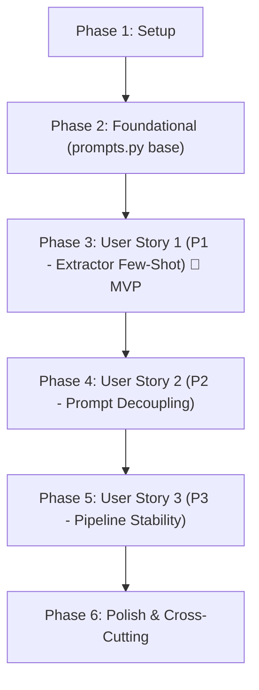

# Tasks: Few-Shot Prompting no Extractor Node

**Input**: Design documents from `specs/001-few-shot-extractor/`  
**Prerequisites**: `plan.md` (required), `spec.md` (required), `research.md`, `data-model.md`, `contracts/`, `quickstart.md`  

**Tests**: Test validation tasks are included based on the scenarios defined in `specs/001-few-shot-extractor/quickstart.md`.  
**Organization**: Tasks are grouped strictly by user story to enable independent implementation and testability for each story.

---

## Format: `[ID] [P?] [Story] Description with file path`

- **[P]**: Can run in parallel (different files or independent operations without blocking dependencies)
- **[Story]**: Which user story this task belongs to (`[US1]`, `[US2]`, `[US3]`)
- Every task includes explicit file paths

---

## Path Conventions

- **Repository Root**: `/home/davig/agents-workspace/agent-clipper/`
- **Source Files**: `prompts.py`, `orchestrator.py`, `schemas.py`, `config.py`
- **Spec & Verification Files**: `specs/001-few-shot-extractor/quickstart.md`, `specs/001-few-shot-extractor/contracts/`

---

## Phase 1: Setup (Shared Infrastructure)

**Purpose**: Verificação de ambiente e dependências pré-existentes

- [X] T001 Validate Python 3.12 environment and ensure required dependencies (`instructor`, `langgraph`, `openai`, `pydantic`) are accessible in requirements.txt
- [X] T002 Verify accessibility and integrity of schemas in schemas.py and configuration in config.py

---

## Phase 2: Foundational (Blocking Prerequisites)

**Purpose**: Criação do módulo base de prompts para desbloquear a implementação das user stories

**⚠️ CRITICAL**: Must be completed before user story implementation begins

- [X] T003 Create base prompts.py module at repository root with typing imports and docstring adhering to specs/001-few-shot-extractor/contracts/prompts-interface.json

**Checkpoint**: Base `prompts.py` file ready — user story implementation can begin.

---

## Phase 3: User Story 1 — Extração robusta de cortes em podcasts longos (Priority: P1) 🎯 MVP

**Goal**: O `extractor_node` utiliza In-Context Learning com Few-Shot Prompting multi-turno para extrair cortes sem falhas de formatação ou aborto em podcasts longos.

**Independent Test**: Executar teste de mock state via comando documentado em `specs/001-few-shot-extractor/quickstart.md` (seção 3) e confirmar retorno de lista de `CorteVideo` válidos.

### Implementation for User Story 1

- [X] T004 [P] [US1] Implement EXTRACTOR_SYSTEM_PROMPT_TEMPLATE with strict Shorts guidelines in prompts.py
- [X] T005 [P] [US1] Implement EXTRACTOR_FEW_SHOT_EXAMPLES with turn-based mock user transcript/reasoning and mock assistant JSON array conforming to CorteVideo in prompts.py
- [X] T006 [US1] Refactor extractor_node in orchestrator.py to import EXTRACTOR_FEW_SHOT_EXAMPLES and EXTRACTOR_SYSTEM_PROMPT_TEMPLATE from prompts.py
- [X] T007 [US1] Implement multi-turn messages array construction (`[system] + few_shot + [user]`) in extractor_node in orchestrator.py
- [X] T008 [US1] Verify extractor_node against the mock podcast transcript test specified in specs/001-few-shot-extractor/quickstart.md

**Checkpoint**: User Story 1 is functional and can be tested independently as the MVP increment.

---

## Phase 4: User Story 2 — Centralização e manutenibilidade dos prompts (Priority: P2)

**Goal**: Centralizar todos os templates de prompt do pipeline em `prompts.py`, eliminando strings literais em `orchestrator.py` e garantindo isolamento sem dependências circulares.

**Independent Test**: Executar asserção isolada de importação em `specs/001-few-shot-extractor/quickstart.md` (seção 1) e inspecionar `orchestrator.py` para ausência de prompts inline.

### Implementation for User Story 2

- [X] T009 [P] [US2] Implement THINKER_SYSTEM_PROMPT constant for viral creative strategy in prompts.py
- [X] T010 [US2] Refactor thinker_node in orchestrator.py to import and use THINKER_SYSTEM_PROMPT from prompts.py
- [X] T011 [US2] Audit and remove any remaining inline prompt strings in orchestrator.py
- [X] T012 [US2] Execute isolated imports verification for prompts.py per specs/001-few-shot-extractor/quickstart.md

**Checkpoint**: User Stories 1 AND 2 are complete. All prompt definitions are fully decoupled into `prompts.py`.

---

## Phase 5: User Story 3 — Estabilidade do pipeline pós-refatoração (Priority: P3)

**Goal**: Assegurar estabilidade ponta a ponta do DAG LangGraph, integridade do `VideoState` e manutenção estrita dos parâmetros locais da API Ollama.

**Independent Test**: Executar teste de compilação do grafo em `specs/001-few-shot-extractor/quickstart.md` (seção 2) e verificar que os 6 nós e parâmetros de conexão continuam idênticos.

### Implementation for User Story 3

- [X] T013 [US3] Validate that API parameters (`base_url`, `model`, `temperature=0.1`) in orchestrator.py remain unchanged
- [X] T014 [US3] Validate that VideoState TypedDict definition in orchestrator.py has no added or removed fields
- [X] T015 [US3] Validate LangGraph workflow DAG compilation with all 6 nodes intact per specs/001-few-shot-extractor/quickstart.md

**Checkpoint**: Pipeline stability verified with zero regressions across DAG, state, and API parameters.

---

## Phase 6: Polish & Cross-Cutting Concerns

**Purpose**: Validação final de conformidade com `AGENTS.md`, formatação limpa e documentação

- [X] T016 [P] Verify code style, English naming conventions and minimal comment guidelines in prompts.py and orchestrator.py
- [X] T017 Verify that no Regex (`re.search`) or manual `json.loads` was introduced in orchestrator.py
- [X] T018 Execute end-to-end quickstart validation suite from specs/001-few-shot-extractor/quickstart.md
- [X] T019 [P1] Remove hardcoded video_id/video_url in config.py and ensure YOUTUBE_URL is strictly dynamic via os.getenv without fallback
- [X] T020 [P3] Clean up duplicate inline gc imports and unused module-level imports in ingestion.py and editor.py
- [X] T021 [P4] Remove hardcoded '/app/output' default argument in node_0.py by referencing OUTPUT_DIR from config.py

---

## Dependencies & Execution Order

### Phase Dependencies

### User Story Dependencies

- **User Story 1 (P1)**: Depends on Foundational Phase (`T003`). Delivers the core Few-Shot anchoring for `extractor_node`.
- **User Story 2 (P2)**: Extends `prompts.py` to migrate `THINKER_SYSTEM_PROMPT` and cleans up inline prompts in `orchestrator.py`.
- **User Story 3 (P3)**: Validates non-regression of the full DAG and state once both nodes are refactored.

### Parallel Opportunities

- Within Phase 3 (US1): `T004` (`EXTRACTOR_SYSTEM_PROMPT_TEMPLATE`) and `T005` (`EXTRACTOR_FEW_SHOT_EXAMPLES`) can be authored in parallel.
- Within Phase 4 (US2): `T009` (`THINKER_SYSTEM_PROMPT`) can be authored independently.
- Within Phase 6 (Polish): `T016` (code style audit) can run in parallel with architectural constraint checks.

---

## Implementation Strategy

### MVP First (User Story 1 Only)

1. Complete Phase 1 (Setup) and Phase 2 (Foundational: `prompts.py` stub).
2. Complete Phase 3 (User Story 1: `T004` through `T008`).
3. **STOP and VALIDATE**: Test `extractor_node` independently using mock state (`quickstart.md` Step 3).
4. Verify that `CorteVideo` list is generated without exception under stress.

### Incremental Delivery

1. Setup + Foundational → Base module ready.
2. User Story 1 → Extractor Few-Shot operational (MVP achieved).
3. User Story 2 → Thinker prompt migrated and prompts centralized.
4. User Story 3 → Full DAG compiled and state integrity validated.
5. Polish → Clean code and strict `AGENTS.md` verification.

---

## Notes

- Strict adherence to `AGENTS.md`: No Regex, no heavy telemetry, no secondary LLMs.
- Turn-based multi-turn message payload is used rather than string concatenation in system prompt.
- Every task specifies explicit file paths for unambiguous agent execution.
