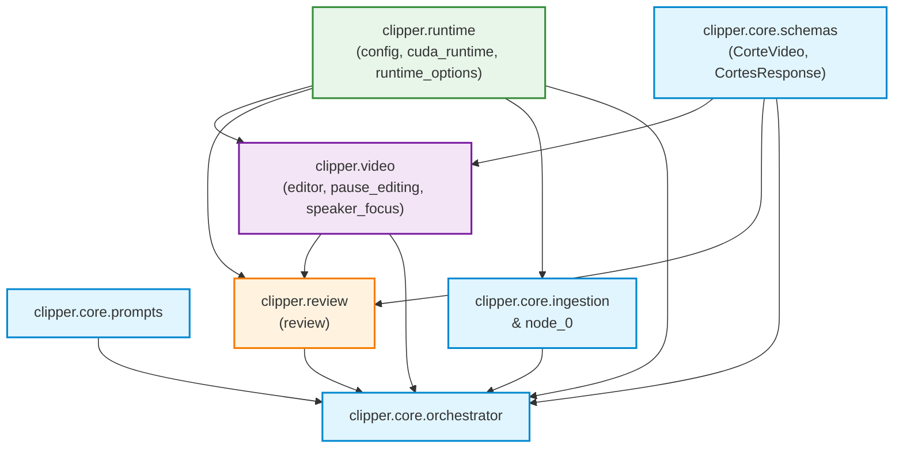

# Phase 1 Data Model & Architecture Design: Modular Domain Layout

**Feature Branch**: `009-repo-restructure`  
**Date**: 2026-10-27  
**Spec**: [spec.md](spec.md)  
**Research**: [research.md](research.md)  

## Architectural Domains & Package Map

```
src/clipper/
├── __init__.py
├── core/
│   ├── __init__.py
│   ├── ingestion.py
│   ├── node_0.py
│   ├── orchestrator.py
│   ├── prompts.py
│   └── schemas.py
├── video/
│   ├── __init__.py
│   ├── editor.py
│   ├── pause_editing.py
│   └── speaker_focus.py
├── review/
│   ├── __init__.py
│   └── review.py
└── runtime/
    ├── __init__.py
    ├── config.py
    ├── cuda_runtime.py
    └── runtime_options.py
```

---

## Domain Responsibilities & Module Catalog

### 1. `clipper.core` (Pipeline & State Management)

| Module | Source (Pre-refactor) | Primary Responsibilities |
|---|---|---|
| `schemas.py` | `schemas.py` | Defines Pydantic data schemas: `CorteVideo`, `CortesResponse`. |
| `prompts.py` | `prompts.py` | Thinker and Extrator system prompts, few-shot prompt structures, format definitions. |
| `ingestion.py` | `ingestion.py` | Video download (`YoutubeDL`), audio extraction, and transcription (`WhisperModel`). |
| `node_0.py` | `node_0.py` | Preventative silence slicing via FFmpeg `silencedetect` for long videos. |
| `orchestrator.py` | `orchestrator.py` | LangGraph `StateGraph`, `VideoState` TypedDict, cognitive routing execution, SQLite checkpointing. |

### 2. `clipper.video` (Media Composition & Audio-Visual Processing)

| Module | Source (Pre-refactor) | Primary Responsibilities |
|---|---|---|
| `editor.py` | `editor.py` | MoviePy 1.0.3 composition, 9:16 vertical cropping, caption wrapping and subtitle rendering. |
| `pause_editing.py` | `pause_editing.py` | `PauseSettings`, `PausePlan`, interval calculation, speech pause shortening, caption timestamp remapping. |
| `speaker_focus.py` | `speaker_focus.py` | `FramingPlan`, active speaker face detection, static close-ups, and reframing metadata. |

### 3. `clipper.review` (Human-in-the-Loop Gate)

| Module | Source (Pre-refactor) | Primary Responsibilities |
|---|---|---|
| `review.py` | `review.py` | `ReviewManifest`, local HTTP review server, preview playback, and cut authorization endpoints. |

### 4. `clipper.runtime` (Environment & Infrastructure Bootstrap)

| Module | Source (Pre-refactor) | Primary Responsibilities |
|---|---|---|
| `config.py` | `config.py` | Environment variable parsing, directory path resolution (`PROJECT_ROOT`, `OUTPUT_DIR`), hardware thresholds. |
| `cuda_runtime.py` | `cuda_runtime.py` | Dynamic loading of CUDA libraries (`libcublas`, `libcudnn`), validation of GPU vs CPU profiles. |
| `runtime_options.py` | `runtime_options.py` | Interactive terminal UI menu, CLI argument parsing for LLM provider/model selection. |

---

## Package Dependency Graph (Strictly Acyclic)



### Invariant Rules
1. `clipper.runtime` depends ONLY on standard libraries and external packages (`dotenv`, `ctypes`). It NEVER imports from `core`, `video`, or `review`.
2. `clipper.core.schemas` depends ONLY on `pydantic`.
3. `clipper.video` depends on `clipper.runtime.config` and `clipper.core.schemas`. It NEVER imports from `review` or `orchestrator`.
4. `clipper.review` depends on `clipper.core.schemas`, `clipper.video.pause_editing`, and `clipper.runtime.config`. It NEVER imports from `orchestrator`.
5. `clipper.core.orchestrator` is the composition root uniting the DAG nodes.

---

## Root Directory State Mapping

### Retained in Root
- `dockerfile`
- `run_pipeline.sh`
- `requirements.txt`
- `requirements-cuda.txt`
- `requirements-gpu.txt`
- `AGENTS.md`
- `README.md`
- `.env.example`
- `.gitignore`
- `.dockerignore`

### Relocated from Root
- All 12 application modules -> `src/clipper/<domain>/`
- All 9 test modules (`test_*.py`) -> `tests/`
- `prompts_revisado.txt` -> `docs/prompts_revisado.txt`
