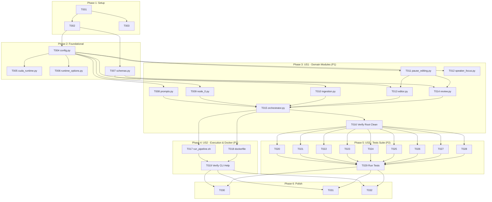

# Tasks: Modular Domain Repository Restructuring

**Feature Branch**: `009-repo-restructure`  
**Input**: Design documents from `specs/009-repo-restructure/`  
**Prerequisites**: `spec.md`, `plan.md`, `research.md`, `data-model.md`, `contracts/`, `quickstart.md`

## Format: `[ID] [P?] [Story] Description`

- **[P]**: Can run in parallel (different files, no dependencies)
- **[Story]**: Which user story this task belongs to (`[US1]`, `[US2]`, `[US3]`)
- Every task includes exact file paths

---

## Phase 1: Setup (Directory Structure & Environment Preparation)

**Purpose**: Create the modular directory hierarchy and move documentation artifacts.

- [X] T001 Create directory tree for `src/clipper/core`, `src/clipper/video`, `src/clipper/review`, `src/clipper/runtime`, `tests/`, and `docs/`
- [X] T002 [P] Create package marker files `src/clipper/__init__.py`, `src/clipper/core/__init__.py`, `src/clipper/video/__init__.py`, `src/clipper/review/__init__.py`, `src/clipper/runtime/__init__.py`, and `tests/__init__.py` (injecting `src/` into `sys.path` so standard `python -m unittest discover tests/` works without manual environment exports)
- [X] T003 [P] Move draft notes from repository root to `docs/prompts_revisado.txt`

---

## Phase 2: Foundational (Runtime Infrastructure & Root Anchoring)

**Purpose**: Establish base runtime configuration, schemas, and CUDA environment that all domain modules depend upon.

**⚠️ CRITICAL**: Must be completed before relocating domain services or running tests.

- [X] T004 Move and update `config.py` to `src/clipper/runtime/config.py` anchoring `PROJECT_ROOT = Path(__file__).resolve().parents[3]`
- [X] T005 [P] Move and update `cuda_runtime.py` to `src/clipper/runtime/cuda_runtime.py` with imports from `clipper.runtime.config`
- [X] T006 [P] Move and update `runtime_options.py` to `src/clipper/runtime/runtime_options.py`
- [X] T007 [P] Move and update `schemas.py` to `src/clipper/core/schemas.py`

**Checkpoint**: Foundation ready — domain services and user story implementation can proceed.

---

## Phase 3: User Story 1 - Clear Codebase Navigation by Domain (Priority: P1) 🎯 MVP

**Goal**: Organize all core, video, and review application modules into domain subpackages with clean, non-circular imports.

**Independent Test**: Root directory contains no loose `.py` application modules; importing `clipper.core.orchestrator` via `python -c "import clipper.core.orchestrator"` succeeds without error.

### Implementation for User Story 1

- [X] T008 [P] [US1] Move and update `prompts.py` to `src/clipper/core/prompts.py`
- [X] T009 [P] [US1] Move and update `node_0.py` to `src/clipper/core/node_0.py` importing `from clipper.runtime.config import OUTPUT_DIR`
- [X] T010 [P] [US1] Move and update `ingestion.py` to `src/clipper/core/ingestion.py` importing from `clipper.runtime.config`
- [X] T011 [P] [US1] Move and update `pause_editing.py` to `src/clipper/video/pause_editing.py` importing from `clipper.runtime.config`
- [X] T012 [P] [US1] Move and update `speaker_focus.py` to `src/clipper/video/speaker_focus.py` importing from `clipper.runtime.config`
- [X] T013 [US1] Move and update `editor.py` to `src/clipper/video/editor.py` importing from `clipper.core.schemas`, `clipper.video.pause_editing`, and `clipper.runtime.config`
- [X] T014 [US1] Move and update `review.py` to `src/clipper/review/review.py` importing from `clipper.core.schemas`, `clipper.video.pause_editing`, and `clipper.runtime.config`
- [X] T015 [US1] Move and update `orchestrator.py` to `src/clipper/core/orchestrator.py` importing from `clipper.core.*`, `clipper.video.*`, `clipper.review.*`, and `clipper.runtime.*`
- [X] T016 [US1] Verify no deprecated root `.py` source files remain (using `git mv` in preceding steps) and verify module resolution with `PYTHONPATH=src python -c "import clipper.core.orchestrator"`

**Checkpoint**: At this point, User Story 1 is complete. Codebase is modularized and importable under `src/clipper`.

---

## Phase 4: User Story 2 - Seamless Execution and Container Compatibility (Priority: P1)

**Goal**: Ensure `run_pipeline.sh` and `dockerfile` execute the application cleanly through the new package structure.

**Independent Test**: Running `./run_pipeline.sh --help` displays usage without import or file-not-found errors; Docker image builds and invokes `python -m clipper.core.orchestrator`.

### Implementation for User Story 2

- [ ] T017 [US2] Update `run_pipeline.sh` to export `PYTHONPATH="$project_dir/src${PYTHONPATH:+:$PYTHONPATH}"` and route execution through `clipper.core.orchestrator`, `clipper.runtime.cuda_runtime`, or pass-through for `-m` and custom python commands
- [ ] T018 [P] [US2] Update `dockerfile` with `ENV PYTHONPATH=/app/src` and `CMD ["python", "-m", "clipper.core.orchestrator"]`
- [ ] T019 [US2] Verify entrypoint execution by running `./run_pipeline.sh --help` from repository root

**Checkpoint**: User Stories 1 and 2 are complete. Pipeline can be launched locally and in Docker without regressions.

---

## Phase 5: User Story 3 - Comprehensive Test Suite Execution (Priority: P2)

**Goal**: Relocate all 9 test suites to `tests/`, update module import paths and `@patch` targets, and ensure full test suite discovery passes.

**Independent Test**: Executing `PYTHONPATH=src venv/bin/python -m unittest discover tests/ -p "test_*.py"` discovers and runs all tests without import failures or broken mock patches.

### Implementation for User Story 3

- [ ] T020 [P] [US3] Move and update `test_cuda_bootstrap.py` to `tests/test_cuda_bootstrap.py` updating mock targets to `clipper.runtime.cuda_runtime`
- [ ] T021 [P] [US3] Move and update `test_cuda_runtime.py` to `tests/test_cuda_runtime.py`, updating subprocess execution from `orchestrator.py` to `"-m", "clipper.core.orchestrator"` with `cwd=PROJECT_ROOT` and `PYTHONPATH=src`
- [ ] T022 [P] [US3] Move and update `test_runtime_options.py` to `tests/test_runtime_options.py`, updating imports, mock targets, and subprocess execution from `orchestrator.py` to `"-m", "clipper.core.orchestrator"` with `cwd=PROJECT_ROOT` and `PYTHONPATH=src`
- [ ] T023 [P] [US3] Move and update `test_transcription.py` to `tests/test_transcription.py` updating imports to `clipper.core.ingestion`
- [ ] T024 [P] [US3] Move and update `test_llm_api.py` to `tests/test_llm_api.py` updating imports and patches to `clipper.core.orchestrator`
- [ ] T025 [P] [US3] Move and update `test_editor_render.py` to `tests/test_editor_render.py` updating imports and patches to `clipper.video.editor`
- [ ] T026 [P] [US3] Move and update `test_pause_editing.py` to `tests/test_pause_editing.py` updating imports and patches across `clipper.video` and `clipper.review`
- [ ] T027 [P] [US3] Move and update `test_review.py` to `tests/test_review.py` updating imports and patches to `clipper.review.review` and `clipper.core.orchestrator`
- [ ] T028 [P] [US3] Move and update `test_speaker_focus.py` to `tests/test_speaker_focus.py` updating imports and patches to `clipper.video.speaker_focus`
- [ ] T029 [US3] Execute full test suite via `PYTHONPATH=src venv/bin/python -m unittest discover tests/ -p "test_*.py"` and verify zero regressions

**Checkpoint**: All user stories (US1, US2, US3) are fully functional and verified by tests.

---

## Phase 6: Polish & Cross-Cutting Concerns

**Purpose**: Update documentation, clean up residual artifacts, and verify repository state.

- [ ] T030 [P] Update `README.md` to document the new `src/clipper` layout, tests directory, and updated execution commands
- [ ] T031 [P] Update `AGENTS.md` to reference `src/clipper/` path conventions (path updates only; architectural constraints remain unchanged)
- [ ] T032 Clean up root `__pycache__` directories and verify clean working tree with `git status`

---

## Dependencies & Execution Graph

---

## Parallel Execution Opportunities

- **Setup & Foundational**: `T002`, `T003` run in parallel. `T005`, `T006`, `T007` run in parallel once `T004` completes.
- **User Story 1**: `T008`, `T009`, `T010`, `T011`, and `T012` operate on mutually independent files and can be executed in parallel.
- **User Story 2**: `T018` (`dockerfile`) and `T017` (`run_pipeline.sh`) can be edited in parallel.
- **User Story 3**: Test updates (`T020` through `T028`) each modify separate test files and can proceed in parallel.
