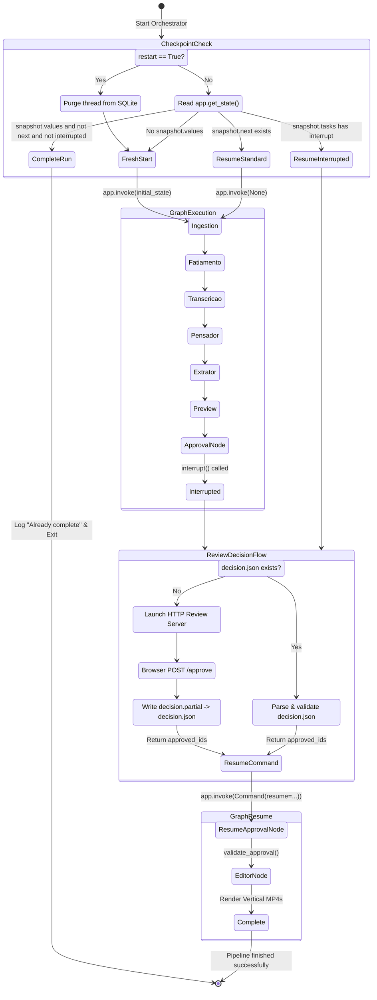

# Data Model & State Architecture: LangGraph Native HITL Integration

**Feature**: `010-manual-review-langgraph-integration`  
**Date**: 2026-10-28  
**Spec**: [spec.md](spec.md) | **Research**: [research.md](research.md)

---

## 1. Core State Entities

### 1.1 VideoState (TypedDict)

The global LangGraph state container that persists across checkpoints in SQLite (`/app/output/estado.db`).

| Field | Type | Description | State Lifecycle |
|---|---|---|---|
| `video_url` | `str` | YouTube URL being processed. | Initialized at START |
| `video_path` | `str` | Local absolute path of downloaded source MP4. | Populated by `download` node |
| `audio_chunks` | `list` | Sliced audio segment paths and time offsets. | Populated by `fatiamento` node |
| `transcript_grouped` | `str` | Aggregated transcript text grouped by phrases. | Populated by `transcricao` node |
| `word_timestamps` | `list[dict]` | High-granularity word timestamps for subtitles. | Populated by `transcricao` node |
| `raciocinio_bruto` | `str` | Free-form editorial reasoning text from Thinker. | Populated by `pensador` node |
| `cortes_finais` | `list[dict]` | Validated list of cuts extracted via Instructor. | Populated by `extrator` node |
| `review_directory` | `str` | Absolute path containing `review.json` & previews. | Populated by `preview` node |
| `review_session` | `str` | Unique UUID for the review session lifecycle. | Initialized at START (refreshed on restart) |
| `approved_cut_ids` | `list[int]` | Sorted list of human-approved 1-based cut IDs. | Populated by `approval` node upon resume |
| `approval_complete` | `bool` | Strict guard ensuring approval before editing. | Set to `True` by `approval` node |

---

### 1.2 HITL Suspension & Resume Payloads

#### Interrupt Payload (`approval_node` -> Orchestrator)
When `approval_node` calls `interrupt(payload)`, this dictionary is serialized into LangGraph's task checkpoint:
```python
{
    "review_directory": str,  # e.g., "/app/output/reviews/abc123def456"
    "cut_count": int          # Total candidate cuts available for selection
}
```

#### Resume Payload (Orchestrator -> `Command(resume=...)`)
The structured decision delivered back into `approval_node`'s `interrupt()` return value:
```python
{
    "approved_ids": list[int]  # 1-based indices of approved cuts, e.g. [1, 3] or [] (reject all)
}
```

---

### 1.3 Persistent File Artifacts

#### ReviewManifest (`review.json`)
Created by `prepare_review` in the review directory. Defines candidate cuts and timing plans.
```json
{
  "cuts": [
    {
      "start_time": 12.5,
      "end_time": 45.0,
      "title": "Abertura impactante",
      "description": "Explicação do problema principal"
    }
  ],
  "pause_plans": [
    {
      "source_start": 12.5,
      "source_end": 45.0,
      "duration": 30.2,
      "kept": [[12.5, 20.0], [21.0, 45.0]],
      "removals": [[20.0, 21.0]]
    }
  ]
}
```

#### Decision Record (`decision.json`)
Written atomically via `.partial` file rename before the HTTP server responds to the browser.
```json
{
  "approved_ids": [1]
}
```

---

## 2. Checkpoint Database Schema (SQLite)

LangGraph's `SqliteSaver` manages two primary tables in `/app/output/estado.db`:

```sql
CREATE TABLE IF NOT EXISTS checkpoints (
    thread_id TEXT NOT NULL,
    checkpoint_ns TEXT NOT NULL DEFAULT '',
    checkpoint_id TEXT NOT NULL,
    parent_checkpoint_id TEXT,
    type TEXT,
    checkpoint BLOB,
    metadata BLOB,
    PRIMARY KEY (thread_id, checkpoint_ns, checkpoint_id)
);

CREATE TABLE IF NOT EXISTS writes (
    thread_id TEXT NOT NULL,
    checkpoint_ns TEXT NOT NULL DEFAULT '',
    checkpoint_id TEXT NOT NULL,
    task_id TEXT NOT NULL,
    task_path TEXT NOT NULL DEFAULT '',
    idx INTEGER NOT NULL,
    channel TEXT NOT NULL,
    type TEXT,
    value BLOB,
    PRIMARY KEY (thread_id, checkpoint_ns, checkpoint_id, task_id, idx)
);
```

### Invalidation Logic on `--restart`
```python
def purge_thread_checkpoints(conn, thread_id: str) -> None:
    with conn:
        conn.execute("DELETE FROM checkpoints WHERE thread_id = ?", (thread_id,))
        conn.execute("DELETE FROM writes WHERE thread_id = ?", (thread_id,))
```

---

## 3. State Transition Model



---

## 4. Invariants & Data Integrity Rules

1. **Deterministic Thread ID**:
   $$\text{thread\_id} = \text{"clipper\_review\_v3\_"} + \text{SHA256}(\text{video\_url} \parallel \text{LLM\_PROVIDER} \parallel \text{MODEL\_NAME} \parallel \text{LLM\_BASE\_URL} \parallel \text{PauseSettings})[:24]$$
2. **Atomic Decision Write**:
   Writing `decision.json` must always occur by writing to temporary file `decision.partial.json` followed by atomic filesystem replacement (`Path.replace()`).
3. **Approval Validation Invariant**:
   Every ID in `approved_ids` must satisfy $1 \le \text{ID} \le \text{len}(\text{cortes\_finais})$, contain no duplicates, and be strict integers. Empty list `[]` is valid and represents "Reject all".
4. **Editor Isolation Invariant**:
   `editor_node` must strictly assert `state.get("approval_complete") is True` and `approved_cut_ids` is validated against `cortes_finais`. If `approved_cut_ids` is empty, rendering is skipped cleanly.
