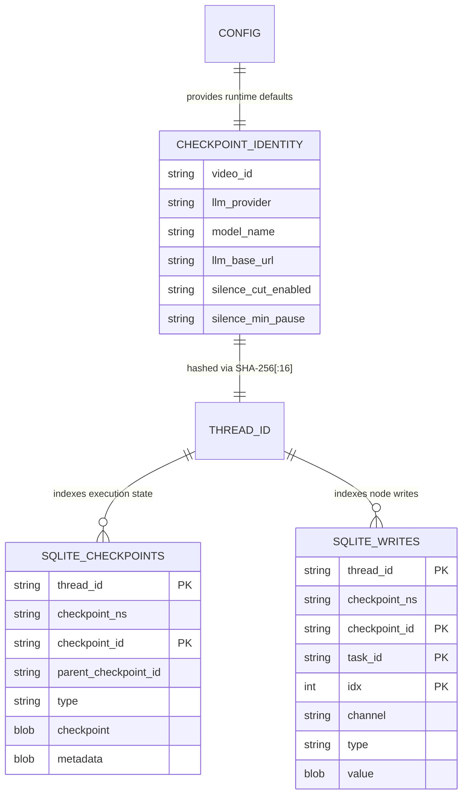
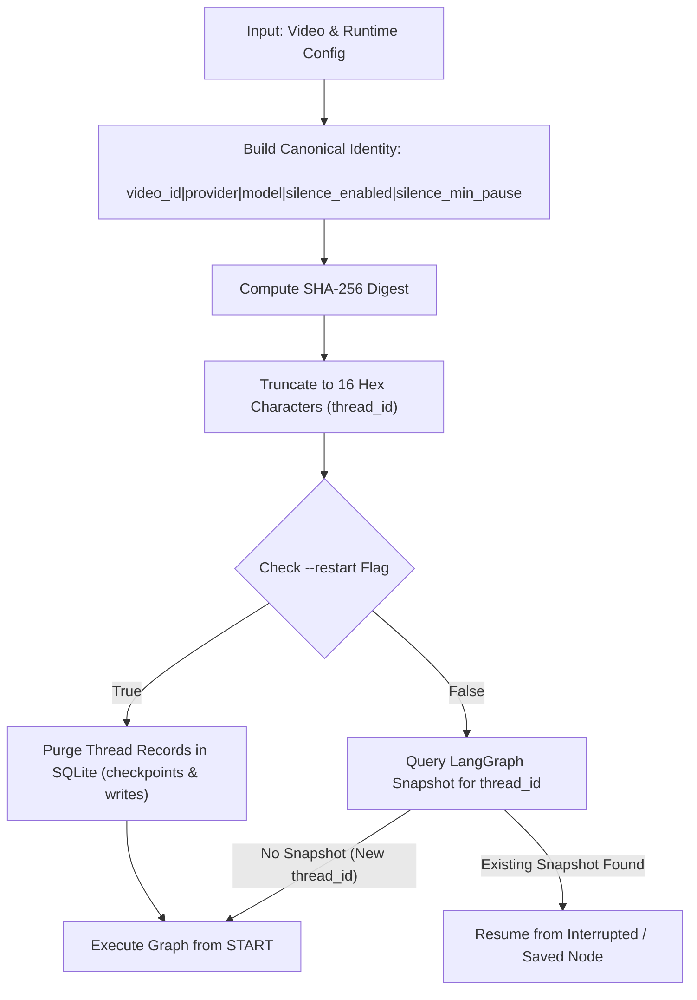

# Data Model & State Architecture: Checkpoint Thread ID Hardening

**Feature**: `011-checkpoint-thread-id-hardening`  
**Date**: 2026-10-28  
**Spec**: [spec.md](spec.md) | **Research**: [research.md](research.md)

---

## 1. Core Entities

### 1.1 CheckpointIdentity (Logical Entity)

Represents the deterministic identity tuple used to generate the LangGraph `thread_id`.

| Field | Type | Required | Default Value | Description | Canonical Representation |
|---|---|---|---|---|---|
| `video_id` | `str` | Yes | `""` | Raw YouTube video identifier or video name. | `str(video_id).strip()` |
| `llm_provider` | `str` | Optional | `LLM_PROVIDER` (from `config.py`) | Selected LLM backend (`ollama` or `gemini`). | `str(provider).strip().lower()` |
| `model_name` | `str` | Optional | `MODEL_NAME` (from `config.py`) | Model name (e.g. `qwen2.5:14b`, `gemini-3.6-flash`). | `str(model_name).strip()` |
| `llm_base_url` | `str` | Optional | `LLM_BASE_URL` (from `config.py`) | Endpoint base URL for model inference. | `str(endpoint).strip().rstrip('/')` |
| `silence_cut_enabled` | `bool \| str` | Optional | `SILENCE_CUT_ENABLED` (from `config.py`) | Flag indicating whether silence removal is active. | `"true"` if enabled else `"false"` |
| `silence_min_pause` | `float \| str` | Optional | `SILENCE_MIN_PAUSE` (from `config.py`) | Minimum pause duration in seconds. | `str(float(pause))` (e.g., `"0.6"`) |

#### Canonical String Serialization Formula:
```text
payload = f"{clean_video_id}|{clean_provider}|{clean_model}|{clean_endpoint}|{clean_silence_enabled}|{clean_silence_min_pause}"
```

#### Hash Derivation:
```text
thread_id = hashlib.sha256(payload.encode("utf-8")).hexdigest()[:16]
```

---

### 1.2 Thread ID (`thread_id`)

The primary execution session identifier consumed by LangGraph checkpointers.

- **Type**: `str`
- **Format**: Lowercase hexadecimal string, length exactly 16 characters (`^[0-9a-f]{16}$`).
- **Domain**: Uniformly distributed within $\{0, 1, ..., 2^{64}-1\}$.
- **Lifecycle**:
  1. Derived once during orchestrator startup (`checkpoint_thread_id(...)`).
  2. Injected into LangGraph configuration: `{"configurable": {"thread_id": thread_id}}`.
  3. Used as the partition key (`thread_id`) in SQLite tables `checkpoints` and `writes` inside `/app/output/estado.db`.
  4. Used by `purge_thread_checkpoints(checkpointer, thread_id)` when running with `--restart`.

---

## 2. Entity Relationships & Database Mapping



---

## 3. Workflow & Invalidation State Transitions



---

## 4. Invalidation & Context Isolation Matrix

| Prior Execution | New Execution | `thread_id` Match? | Behavior |
|---|---|---|---|
| Video X, `ollama`, `qwen2.5:14b`, `silence=true`, `0.6s` | Video X, `gemini`, `gemini-3.6-flash`, `silence=true`, `0.6s` | **NO** | Brand new thread. Starts from scratch; no VRAM or schema conflict. |
| Video X, `gemini`, `gemini-3.6-flash`, `silence=false`, `0.6s` | Video X, `gemini`, `gemini-3.6-flash`, `silence=true`, `0.6s` | **NO** | Brand new thread. Re-computes pause detection and review plan. |
| Video X, `gemini`, `gemini-3.6-flash`, `silence=true`, `0.6s` | Video X, `gemini`, `gemini-3.6-flash`, `silence=true`, `1.0s` | **NO** | Brand new thread. Generates fresh pause cuts for new threshold. |
| Video X, `gemini`, `gemini-3.6-flash`, `silence=true`, `0.6s` | Video X, `gemini`, `gemini-3.6-flash`, `silence=true`, `0.6s` | **YES** | Legitimate crash recovery. Resumes from last saved checkpoint. |
| Legacy Run (v3 prefix: `clipper_review_v3_...`) | Any run with hardened logic | **NO** | Legacy checkpoint orphaned; starts clean run. |
