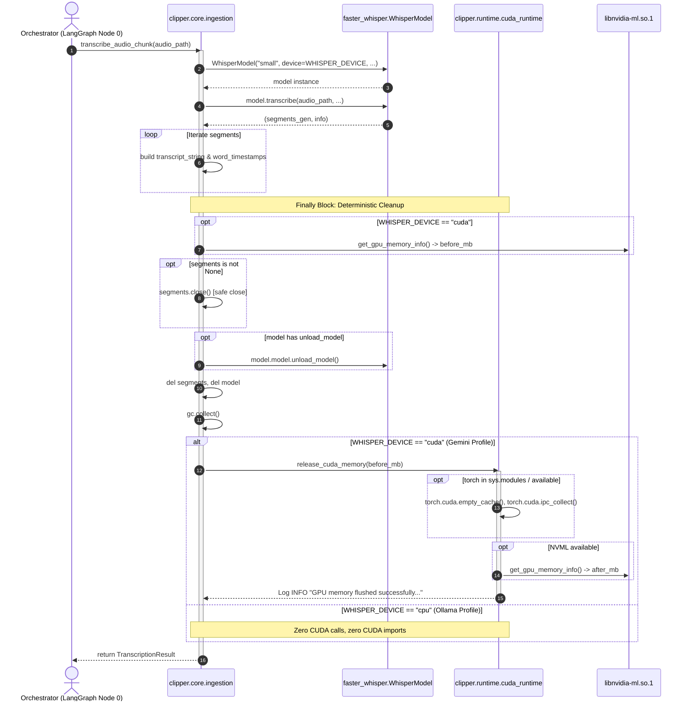

# Phase 1 Data Model: Deep CUDA VRAM Cleanup in Gemini Profile

**Branch**: `012-cuda-vram-cleanup` | **Date**: 2026-10-29 | **Spec**: [spec.md](spec.md)

---

## 1. Entities & Data Structures

### Entity 1: `VRAMSnapshot`

Represents a point-in-time measurement of GPU device memory obtained via NVML or CUDA runtime.

| Field | Type | Description | Required | Validation Rules |
|---|---|---|---|---|
| `used_mb` | `float` | Memory allocated/used on device in megabytes | Yes | `used_mb >= 0.0` |
| `free_mb` | `float` | Free device memory available in megabytes | Yes | `free_mb >= 0.0` |
| `total_mb` | `float` | Total physical memory on device in megabytes | Yes | `total_mb > 0.0` |
| `timestamp` | `float` | Monotonic or epoch timestamp of reading | Yes | System timestamp |

---

### Entity 2: `GPUCleanupEvent`

Represents the execution outcome of a single GPU memory flush sequence between transcription chunks.

| Field | Type | Description | Required | Validation Rules |
|---|---|---|---|---|
| `status` | `str` | Outcome status of the cleanup | Yes | `"flushed"`, `"skipped"`, `"warning"` |
| `before_mb` | `Optional[float]` | VRAM used before cleanup | No | `None` if NVML unavailable |
| `after_mb` | `Optional[float]` | VRAM used after cleanup | No | `None` if NVML unavailable |
| `freed_mb` | `Optional[float]` | Delta memory freed (`before_mb - after_mb`) | No | `None` if NVML unavailable |
| `error_message` | `Optional[str]` | Error details if status is `"warning"` | No | Non-empty string when status is `"warning"` |

---

### Entity 3: `TranscriptionChunk`

The conceptual unit of audio passed to `transcribe_audio_chunk`.

| Field | Type | Description | Required | Validation Rules |
|---|---|---|---|---|
| `audio_path` | `str` | Absolute filesystem path to `.wav` chunk | Yes | File must exist and be readable |
| `chunk_index` | `int` | Sequential chunk index within video | Yes | `>= 0` |

---

### Entity 4: `TranscriptionResult`

The dictionary contract returned by `transcribe_audio_chunk`.

| Field | Type | Description | Required | Validation Rules |
|---|---|---|---|---|
| `status` | `str` | Execution outcome | Yes | `"success"` or `"error"` |
| `transcript` | `Optional[str]` | Segment-aggregated transcription text | Conditional | Required when `status == "success"` |
| `word_timestamps` | `Optional[list[dict]]` | Granular word-level timestamps | Conditional | Required when `status == "success"` |
| `message` | `Optional[str]` | Error message on failure | Conditional | Required when `status == "error"` |

---

## 2. Component Execution Lifecycle & Sequence

---

## 3. State & Resource Invariants

1. **Idempotent Invocation**: Calling `release_cuda_memory()` consecutively produces no errors and does not corrupt GPU context state.
2. **Deterministic Baseline Retention**: For consecutive chunks $N$ and $N+1$, VRAM usage post-cleanup satisfies:
   $$\text{VRAM}_{\text{after}}(N+1) \le \text{VRAM}_{\text{after}}(N) \times 1.05$$
   (No cumulative monotonic memory growth).
3. **Fault Tolerance**: If `release_cuda_memory()` raises an unhandled internal exception, it is caught at the boundary, logged as a WARNING, and suppressed so `transcribe_audio_chunk` returns the valid `TranscriptionResult` to the caller.
4. **Zero-Side-Effect on CPU**: When `WHISPER_DEVICE != "cuda"`, no GPU library or driver call is initiated.
