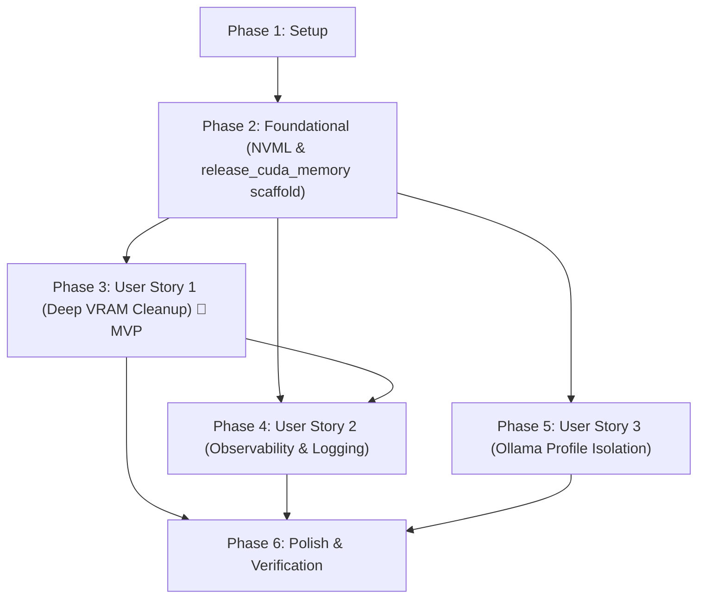

# Tasks: Deep CUDA VRAM Cleanup in Gemini Profile

**Input**: Design documents from `/specs/012-cuda-vram-cleanup/`  
**Prerequisites**: [plan.md](plan.md) (required), [spec.md](spec.md) (required for user stories), [research.md](research.md), [data-model.md](data-model.md), [contracts/cuda-vram-cleanup-contract.md](contracts/cuda-vram-cleanup-contract.md), [quickstart.md](quickstart.md)

**Tests**: Unit and regression tests are explicitly required by `spec.md` (FR-001–FR-007, SC-001–SC-005) and `quickstart.md`.

**Organization**: Tasks are grouped by user story to enable independent implementation and testing of each story.

## Format: `[ID] [P?] [Story] Description`

- **[P]**: Can run in parallel (different files, no dependencies)
- **[Story]**: Which user story this task belongs to (e.g., US1, US2, US3)
- Include exact file paths in descriptions

## Path Conventions

- Single Python project: `src/clipper/`, `tests/` at repository root

---

## Phase 1: Setup (Shared Infrastructure)

**Purpose**: Verify virtual environment, CUDA runtime dependencies, and existing transcription tests before making modifications

- [x] T001 Verify Python virtual environment, dependencies (`faster-whisper`, `ctranslate2`, `torch` if available), and test runner via tests/test_transcription.py
- [x] T002 [P] Inspect runtime configuration variables (`WHISPER_DEVICE`, `WHISPER_COMPUTE_TYPE`, `LLM_PROVIDER`) in src/clipper/runtime/config.py

---

## Phase 2: Foundational (Blocking Prerequisites)

**Purpose**: Core infrastructure and NVML ctypes interface in `src/clipper/runtime/cuda_runtime.py` required before user story wiring

**⚠️ CRITICAL**: No user story work can begin until this phase is complete

- [x] T003 Implement NVML ctypes interface and `get_gpu_memory_info(device_index: int = 0)` helper returning `tuple[float, float, float] | None` with safe error suppression in src/clipper/runtime/cuda_runtime.py
- [x] T004 [P] Scaffold `release_cuda_memory()` function signature, logger binding, and top-level exception guard structure in src/clipper/runtime/cuda_runtime.py

**Checkpoint**: Foundation ready - NVML memory query interface and cleanup entry point scaffolded. User story implementation can now begin.

---

## Phase 3: User Story 1 - Long-video Processing Without OOM Crash (Priority: P1) 🎯 MVP

**Goal**: Ensure that in the Gemini (CUDA) profile, transcription of every chunk executes a deep memory release (generator close, CTranslate2 model unload, reference deletion, GC, and CUDA cache flush via `torch.cuda.empty_cache()`/`ipc_collect()`) so VRAM is restored to baseline without cumulative leaks across consecutive chunks.

**Independent Test**: Transcribe multiple chunks in sequence in the Gemini profile and verify that after each chunk, generator is closed, model is unloaded, garbage collection is triggered, CUDA cache is purged, and no exceptions are raised (mocked or live).

### Tests for User Story 1

> **NOTE: Write these tests FIRST, ensure they fail before full implementation**

- [x] T005 [P] [US1] Unit test `release_cuda_memory()` cache purging with PyTorch mocked/loaded in tests/test_cuda_cleanup.py
- [x] T006 [P] [US1] Unit test lazy segment generator safe closure and CTranslate2 model `unload_model()` call in `finally` block in tests/test_transcription.py
- [x] T007 [P] [US1] Integration test verifying multi-chunk sequential execution without cumulative memory retention or unclosed handles in tests/test_cuda_cleanup.py

### Implementation for User Story 1

- [x] T008 [US1] Implement deep cache purge in `release_cuda_memory()` in src/clipper/runtime/cuda_runtime.py invoking `torch.cuda.empty_cache()` and `torch.cuda.ipc_collect()` if PyTorch is loaded/available
- [x] T009 [US1] Refactor `transcribe_audio_chunk()` `finally` block in src/clipper/core/ingestion.py to sample `before_mb` (when `WHISPER_DEVICE == "cuda"`), safely close `segments` (`hasattr(segments, "close")`), invoke `model.model.unload_model()` if available, delete `segments`/`model`, force `gc.collect()`, and call `release_cuda_memory(before_mb=before_mb)` when `WHISPER_DEVICE == "cuda"`

**Checkpoint**: At this point, User Story 1 should be fully functional and testable independently (MVP delivered!).

---

## Phase 4: User Story 2 - Observability of VRAM Release Events (Priority: P2)

**Goal**: Enable the operator to monitor VRAM release events in `pipeline.log` via structured INFO logs with before/after memory metrics when NVML is available, or standard confirmation when NVML is unavailable, and warning logs on cleanup failure without aborting.

**Independent Test**: Inspect logs during simulated or live cleanup runs and verify exact format matching: `"GPU memory flushed successfully: before=%.1f MB, after=%.1f MB (freed=%.1f MB)"` when NVML metrics are available, `"GPU memory flushed successfully."` when NVML is unavailable, and `logger.warning("GPU memory cleanup failed: %s", error)` when an error occurs.

### Tests for User Story 2

- [x] T010 [P] [US2] Unit test structured INFO logging with and without NVML metrics in tests/test_cuda_cleanup.py
- [x] T011 [P] [US2] Unit test exception handling in `release_cuda_memory()` verifying WARNING log emission and non-propagation in tests/test_cuda_cleanup.py

### Implementation for User Story 2

- [x] T012 [US2] Implement before-and-after VRAM sampling (accepting optional `before_mb` parameter) and structured INFO logging in `release_cuda_memory()` within src/clipper/runtime/cuda_runtime.py per contract specifications
- [x] T013 [US2] Add fault-tolerant exception handling and WARNING logging for `release_cuda_memory()` invocations in src/clipper/runtime/cuda_runtime.py and src/clipper/core/ingestion.py

**Checkpoint**: At this point, User Stories 1 AND 2 should both work together: deep cleanup is performed and observable in `pipeline.log` with before/after MB stats or fallback confirmation, with full error resilience.

---

## Phase 5: User Story 3 - Ollama Profile Is Unaffected (Priority: P3)

**Goal**: Guarantee that when running in the Ollama profile (`LLM_PROVIDER=ollama`, `WHISPER_DEVICE=cpu`), zero CUDA libraries are loaded, `release_cuda_memory()` is bypassed, and no CUDA-related logs or exceptions occur.

**Independent Test**: Run transcription with `LLM_PROVIDER=ollama` / `WHISPER_DEVICE=cpu` and verify that `release_cuda_memory()` is not invoked, CUDA libraries are not imported, and no CUDA flush logs appear.

### Tests for User Story 3

- [x] T014 [P] [US3] Unit test profile isolation in tests/test_cuda_cleanup.py asserting that `release_cuda_memory()` is a no-op when `WHISPER_DEVICE != "cuda"` and that `transcribe_audio_chunk()` bypasses CUDA cleanup on CPU

### Implementation for User Story 3

- [x] T015 [US3] Ensure strict guard `if WHISPER_DEVICE != "cuda": return` in `release_cuda_memory()` in src/clipper/runtime/cuda_runtime.py and profile guard `if WHISPER_DEVICE == "cuda":` in src/clipper/core/ingestion.py

**Checkpoint**: All user stories should now be independently functional, verifying both Gemini GPU execution and CPU Ollama isolation.

---

## Phase 6: Polish & Cross-Cutting Concerns

**Purpose**: Documentation synchronization, quickstart validation, and full test suite regression

- [x] T016 [P] Update tests/test_transcription.py and tests/test_cuda_runtime.py to ensure full test suite passes with `discover tests/`
- [x] T017 Validate end-to-end execution scenarios from specs/012-cuda-vram-cleanup/quickstart.md
- [x] T018 Synchronize project documentation in GEMINI.md and AGENTS.md with deep CUDA VRAM cleanup specifications and recent changes

---

## Dependencies & Execution Order

### Phase Dependencies

- **Setup (Phase 1)**: No dependencies - can start immediately.
- **Foundational (Phase 2)**: Depends on Setup completion - BLOCKS all user stories.
- **User Stories (Phase 3+)**: All depend on Foundational phase completion.
  - User Story 1 (P1): Can start immediately after Phase 2.
  - User Story 2 (P2): Depends on Phase 2; integrates with US1 cleanup logic.
  - User Story 3 (P3): Depends on Phase 2; validates isolation of US1/US2 changes.
- **Polish (Phase 6)**: Depends on all user stories being complete.

### User Story Dependencies



### Within Each User Story

- Tests MUST be written first and fail before full implementation.
- Core function implementation before integration with `ingestion.py`.
- Validation of independent test criteria before advancing to next priority.

### Parallel Opportunities

- **Phase 1**: T001 and T002 can run in parallel.
- **Phase 2**: T003 and T004 can run in parallel.
- **Phase 3 (US1)**: Test tasks T005, T006, and T007 can be written in parallel.
- **Phase 4 (US2)**: Test tasks T010 and T011 can be written in parallel.
- **Phase 5 (US3)**: Test task T014 can run in parallel with US2 implementation.
- **Phase 6**: T016 can run in parallel with T017 and T018.

---

## Parallel Example: User Story 1

```bash
# Launch test creation for User Story 1 in parallel:
Task: "Unit test release_cuda_memory() cache purging with PyTorch mocked/loaded in tests/test_cuda_cleanup.py"
Task: "Unit test lazy segment generator safe closure and CTranslate2 model unload_model() call in finally block in tests/test_transcription.py"
Task: "Integration test verifying multi-chunk sequential execution without cumulative memory retention or unclosed handles in tests/test_cuda_cleanup.py"
```

---

## Parallel Example: User Story 2

```bash
# Launch tests for User Story 2 in parallel:
Task: "Unit test structured INFO logging with and without NVML metrics in tests/test_cuda_cleanup.py"
Task: "Unit test exception handling in release_cuda_memory() verifying WARNING log emission and non-propagation in tests/test_cuda_cleanup.py"
```

---

## Parallel Example: User Story 3

```bash
# Launch tests for User Story 3:
Task: "Unit test profile isolation in tests/test_cuda_cleanup.py asserting that release_cuda_memory() is a no-op when WHISPER_DEVICE != 'cuda' and that transcribe_audio_chunk() bypasses CUDA cleanup on CPU"
```

---

## Implementation Strategy

### MVP First (User Story 1 Only)

1. Complete Phase 1: Setup (T001, T002).
2. Complete Phase 2: Foundational (T003, T004 - CRITICAL blocking prerequisites).
3. Complete Phase 3: User Story 1 (T005–T009).
4. **STOP and VALIDATE**: Test User Story 1 independently with `tests/test_cuda_cleanup.py` and `tests/test_transcription.py`.
5. Verify that generator closure, model unloading, and cache flushing prevent memory retention.

### Incremental Delivery

1. Setup + Foundational → NVML interface and cleanup scaffold ready.
2. User Story 1 (P1) → Deep VRAM cleanup fully operational (MVP).
3. User Story 2 (P2) → Observability and structured logging active (`pipeline.log`).
4. User Story 3 (P3) → Ollama CPU-only isolation verified with zero CUDA imports.
5. Polish (Phase 6) → Complete test suite regression passing and docs updated.

---

## Notes

- Every task follows the checklist format `- [ ] [TaskID] [P?] [Story?] Description with file path`.
- [Story] labels (`[US1]`, `[US2]`, `[US3]`) apply strictly to user story phase tasks.
- No heavy external telemetry tools allowed (per `AGENTS.md` Rule 9).
- Clean code and English nomenclature strictly maintained.
