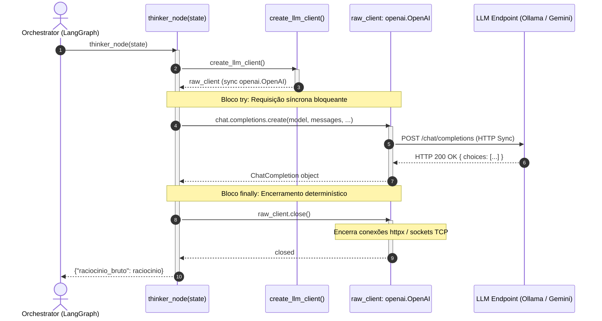
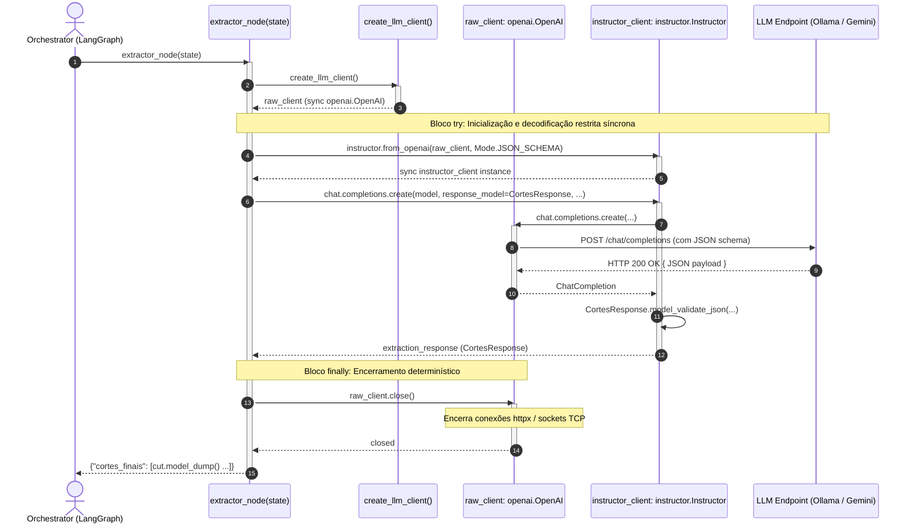

# Phase 1 Data Model: Alinhamento de Concorrência entre Nós LangGraph e Client Instructor

**Branch**: `014-align-instructor-nodes` | **Date**: 2026-10-30 | **Spec**: [spec.md](spec.md)

---

## 1. Entities & Structural Contracts

### Entity 1: `VideoState` (LangGraph Global State)

Estrutura de dados imutável/serializável que trafega exclusivamente URIs de arquivos em disco, primitivos e coleções de dados serializáveis. É expressamente proibido armazenar corrotinas, tarefas assíncronas (`asyncio.Task`), instâncias de clientes ou conexões de rede ativas.

| Field | Type | Description | Required | Validation Rules |
|---|---|---|---|---|
| `video_url` | `str` | URL do vídeo fonte no YouTube | Yes | URL válida formatada |
| `video_path` | `str` | Caminho do arquivo de vídeo no host | Yes | Caminho absoluto do arquivo `.mp4` baixado |
| `audio_chunks` | `list[dict]` | Lista de metadados dos chunks de áudio gerados no fatiamento | Yes | Cada item deve conter `chunk_path` e `offset >= 0.0` |
| `transcript_grouped` | `str` | Transcrição concatenada resumida com timestamps agregados por bloco | Yes | String com intervalos `[INÍCIO - FIM]` formatados |
| `word_timestamps` | `list[dict]` | Granularidade de palavras com timestamps absolutos | Yes | Cada dict contém `word`, `start`, `end` |
| `raciocinio_bruto` | `str` | Raciocínio editorial livre retornado pelo nó Pensador | Yes | String não vazia gerada síncronamente |
| `cortes_finais` | `list[dict]` | Cortes estruturados validados pelo nó Extrator | Yes | Lista de dicionários serializados a partir de `CorteVideo` |
| `review_directory` | `str` | Diretório contendo dados e vídeos de preview para revisão HITL | Yes | Caminho absoluto no diretório de saída |
| `review_session` | `str` | Identificador de sessão de revisão | Yes | Hex string de UUID |
| `approved_cut_ids` | `list[int]` | Índices dos cortes aprovados pelo operador humano | Yes | Lista de inteiros baseados no índice do corte |
| `approval_complete` | `bool` | Indicador de conclusão da fase de aprovação | Yes | Booleano |

---

### Entity 2: `NodeCallable` (Contract for Graph Nodes)

Contrato funcional exigido para 100% dos nós registrados no `StateGraph` da orquestração.

| Aspect | Specification | Validation Rule |
|---|---|---|
| **Definição de Função** | Síncrona convencional (`def node_name(state: VideoState) -> dict:`) | `inspect.iscoroutinefunction(fn) is False` e `asyncio.iscoroutinefunction(fn) is False` |
| **Tipo de Argumento** | `VideoState` (TypedDict) | Mapeamento chave-valor puro |
| **Tipo de Retorno** | `dict` (parcial de atualizações de estado) | Dicionário puro contendo apenas objetos serializáveis |
| **Comportamento Bloqueante** | Bloqueante síncrono na thread corrente | Não inicializa loops de evento assíncronos (`asyncio.run` ou `loop.run_until_complete` interno) |
| **Tratamento de Exceções** | Propagação de erros com encerramento garantido de recursos em `finally` | `try ... finally` determinístico |

---

### Entity 3: `SyncLLMClient` (OpenAI Synchronous Client Specification)

Configuração e contrato do cliente síncrono retornado por `create_llm_client()`.

| Property | Type / Value | Purpose |
|---|---|---|
| **Classe Concreta** | `openai.OpenAI` | Cliente síncrono padrão do SDK OpenAI |
| **Provedores Suportados** | `ollama` (local) ou `gemini` (API remota) | Selecionado via `LLM_PROVIDER` |
| **`api_key`** | `str` | Chave de autenticação (ou string fixa `"ollama"` no perfil local) |
| **`base_url`** | `str` | Endpoint de inferência (`http://localhost:11434/v1` ou `GEMINI_BASE_URL`) |
| **`timeout`** | `float = 180.0` | Limite de espera para evitar travamento da thread |
| **`max_retries`** | `int = 2` | Tentativas de reenvio em erros transitórios |
| **Método de Fechamento** | `close() -> None` | Fecha conexões e transportes HTTP subjacentes (`httpx.Client`) |

---

### Entity 4: `SyncInstructorClient` (Instructor Synchronous Wrapper)

Especificação do encapsulamento de decodificação restrita utilizado no `extractor_node`.

| Property | Value | Purpose |
|---|---|---|
| **Fábrica de Criação** | `instructor.from_openai(raw_client, mode=instructor.Mode.JSON_SCHEMA)` | Envelopa o cliente síncrono base |
| **Classe Resultante** | `instructor.Instructor` | Wrapper síncrono sobre `openai.OpenAI` |
| **Método de Criação** | `chat.completions.create(model=..., response_model=CortesResponse, ...)` | Chamada síncrona bloqueante que retorna instância Pydantic |
| **Modo de Extração** | `Mode.JSON_SCHEMA` com strict JSON schema | Impede alucinações de formatação sem regex |

---

### Entity 5: `CortesResponse` & `CorteVideo` (Pydantic Schemas)

Modelos Pydantic utilizados pelo Instructor para validação estruturada dos cortes.

```python
class CorteVideo(BaseModel):
    title: str = Field(description="Título atrativo e sucinto para o clipe curto")
    description: str = Field(description="Resumo do tema e estratégia de retenção abordada")
    start_time: float = Field(description="Tempo inicial do corte em segundos")
    end_time: float = Field(description="Tempo final do corte em segundos")

class CortesResponse(BaseModel):
    cortes: list[CorteVideo] = Field(description="Lista de cortes editoriais validados")
```

---

## 2. Sequence Diagrams: Synchronous Lifecycle & Resource Disposal

### Diagram 1: Thinker Node (`thinker_node`) Synchronous Lifecycle



---

### Diagram 2: Extractor Node (`extractor_node`) Synchronous Lifecycle


