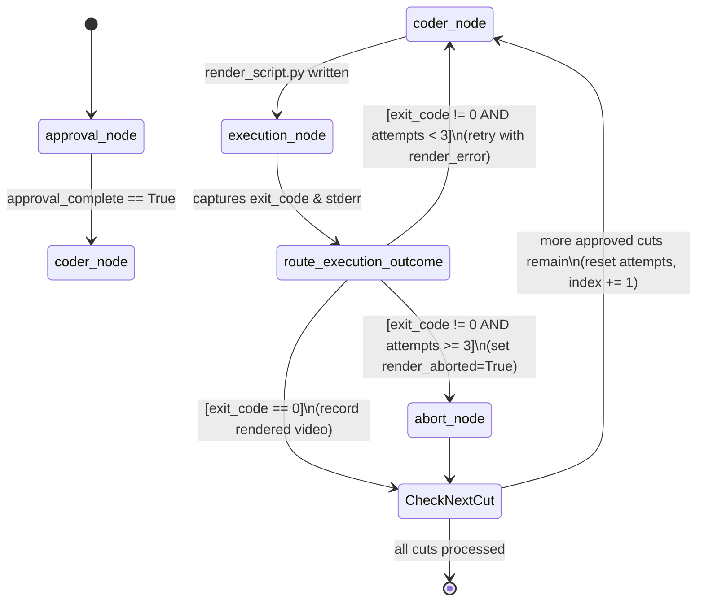

# Data Model: Self-Healing Coder DAG (017)

**Branch**: `017-self-healing-coder-dag` | **Date**: 2026-10-31

---

## Entities

### 1. `RenderScriptPayload` (Pydantic BaseModel)

**Location**: `src/clipper/core/schemas.py`  
**Purpose**: Encapsulates the structured response extracted from the LLM by `coder_node` via Instructor Constrained Decoding. Enforces that the model produces a non-empty, self-contained Python render script without relying on markdown fence stripping or regular expressions.

```python
from pydantic import BaseModel, Field

class RenderScriptPayload(BaseModel):
    script_code: str = Field(
        min_length=1,
        description="Código Python completo e auto-contido para renderização do corte vertical usando MoviePy 1.0.3 e Pillow.",
    )
```

| Field | Type | Required | Constraints | Description |
|---|---|---|---|---|
| `script_code` | `str` | Yes | `min_length=1` | Complete, executable Python script |

**Validation Rules**:
- An empty string `""` or whitespace-only code raises `pydantic.ValidationError` (`string_too_short`), triggering error handling and self-healing.
- Formatted via strict JSON Schema using `openai.pydantic_function_tool(RenderScriptPayload)["function"]["parameters"]` with `strict: True`.

---

### 2. `VideoState` (LangGraph TypedDict) — Extended Fields

**Location**: `src/clipper/core/orchestrator.py`  
**Purpose**: Global state dictionary passed across all nodes in the LangGraph DAG, serialized transparently into SQLite via `SqliteSaver`.

```python
class VideoState(TypedDict):
    # Existing fields
    video_url: str
    video_path: str
    audio_chunks: list
    transcript_grouped: str
    word_timestamps: list
    raciocinio_bruto: str
    cortes_finais: list
    review_directory: str
    review_session: str
    approved_cut_ids: list[int]
    approval_complete: bool
    visual_identity: dict
    style_path: str

    # Feature 017 fields (Self-Healing Coder DAG)
    render_script_path: str      # Path to the generated render_script.py for the current cut
    render_attempts: int         # Execution attempt counter for the current cut (0..3)
    render_error: str            # Captured stderr traceback of the previous failed run (or empty on success)
    render_exit_code: int        # Subprocess exit code (0 on success, non-zero on failure)
    render_aborted: bool         # Boolean flag set to True when all 3 attempts fail for the cut
    current_cut_index: int       # Index in approved_cut_ids currently being processed
    rendered_video_paths: list[str]  # Accumulated list of successfully rendered output MP4 paths
```

| Field | Type | Default | Mutated By | Description |
|---|---|---|---|---|
| `render_script_path` | `str` | `""` | `coder_node` | Path to current cut's `render_script.py` |
| `render_attempts` | `int` | `0` | `execution_node`, `coder_node` | Counter tracking execution attempts for the current cut |
| `render_error` | `str` | `""` | `coder_node`, `execution_node` | Stderr log or error diagnostic from the last failure |
| `render_exit_code` | `int` | `0` | `execution_node` | Subprocess exit status code |
| `render_aborted` | `bool` | `False` | `abort_node` | True if the current cut was aborted after 3 attempts |
| `current_cut_index` | `int` | `0` | router / advance | Index of the approved cut currently being processed |
| `rendered_video_paths` | `list[str]` | `[]` | `execution_node` / router | List of rendered MP4 file paths |

---

### 3. `ExecutionOutcome` (Internal Dataclass / Result)

**Location**: `src/clipper/video/script_executor.py` (or helper in `orchestrator.py`)  
**Purpose**: Clean data structure capturing the result of executing `render_script.py` in an isolated subprocess.

```python
from dataclasses import dataclass

@dataclass(frozen=True)
class ExecutionOutcome:
    exit_code: int
    stdout: str
    stderr: str
    timed_out: bool = False
```

| Field | Type | Description |
|---|---|---|
| `exit_code` | `int` | Process return code (0 = success, non-zero = error) |
| `stdout` | `str` | Captured stdout from the child subprocess |
| `stderr` | `str` | Captured stderr / traceback from the child subprocess |
| `timed_out` | `bool` | True if execution exceeded `RENDER_TIMEOUT_SECONDS` |

---

## State Transitions & Self-Healing Lifecycle



### Lifecycle Rules:
1. **Per-Cut Scope (Assumption 4 & FR-007)**:
   - When a cut starts, `render_attempts` is `0`, `render_error` is `""`, and `render_aborted` is `False`.
   - `render_attempts` is incremented strictly by `execution_node` on every execution attempt (`state.get("render_attempts", 0) + 1`).
2. **Self-Healing Condition (FR-006 & FR-009)**:
   - If `render_exit_code != 0` and `render_attempts < 3`:
     - DAG routes back to `coder_node`.
     - `coder_node` detects non-empty `render_error`, truncates it to `RENDER_ERROR_MAX_CHARS` (default 2000 chars), and feeds it into the LLM prompt together with the previous script.
3. **Abort Condition (FR-008)**:
   - If `render_exit_code != 0` and `render_attempts >= 3`:
     - DAG routes to `abort_node`.
     - `abort_node` marks `render_aborted: True`, logs an editorial error in `pipeline.log`, and proceeds without crashing the orchestrator.
4. **Crash Recovery Persistence (FR-012, SC-005)**:
   - Every node transition commits the entire `VideoState` to `estado.db` via `SqliteSaver`.
   - Resuming after container crash restores `render_attempts`, `render_error`, and `current_cut_index` exactly as persisted.
