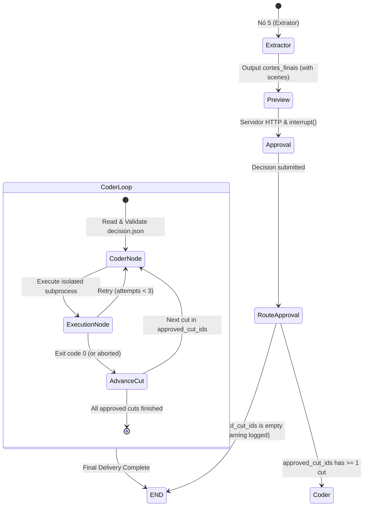

# Phase 1 Data Model: HITL Review Delivery

**Feature**: 019-hitl-review-delivery  
**Date**: 2026-11-02  
**Status**: Completed  

---

## 1. Entities & Schemas

### 1.1 ApprovalDecision Entity
Represents the persisted human-in-the-loop approval decision recorded in `decision.json` and mirrored in `VideoState`.

```python
class ApprovalDecision(BaseModel):
    """
    Schema for decision.json representing human approval of proposed cuts.
    Supports both legacy 'approved_ids' and spec-standard 'approved_cut_ids'.
    """
    approved_ids: list[StrictInt | str] = Field(
        default_factory=list,
        description="List of approved cut identifiers (integers or strings)."
    )
    approved_cut_ids: list[StrictInt | str] = Field(
        default_factory=list,
        description="List of approved cut identifiers (integers or strings), matching spec requirement."
    )

    @model_validator(mode="before")
    @classmethod
    def sync_cut_ids_before(cls, data: Any) -> Any:
        if isinstance(data, dict):
            if "approved_cut_ids" in data and "approved_ids" not in data:
                data = dict(data)
                data["approved_ids"] = data["approved_cut_ids"]
            elif "approved_ids" in data and "approved_cut_ids" not in data:
                data = dict(data)
                data["approved_cut_ids"] = data["approved_ids"]
        return data

    @model_validator(mode="after")
    def sync_cut_ids_after(self):
        if not self.approved_cut_ids and self.approved_ids:
            self.approved_cut_ids = list(self.approved_ids)
        elif not self.approved_ids and self.approved_cut_ids:
            self.approved_ids = list(self.approved_cut_ids)
        return self
```

**Validation Rules**:
- Missing, corrupt, or unparseable `decision.json` fails validation fast with `ValueError`.
- Empty lists `[]` are valid decisions indicating rejection of all cuts.
- Identifiers may be integers (`1`, `2`) or strings (`"cut-0"`, `"cut_42"`).
- `validate_approval(value, cut_count)` validates both integer 1-based indices (`1 <= idx <= cut_count`) and non-empty string identifiers without raising `TypeError`.

---

### 1.2 Scene Entity (Existing & Sanitized)
Represents a planned video scene within a cut, displayed in the review interface and translated to MoviePy clip operations.

```python
class Scene(BaseModel):
    start_word: str = Field(
        default="",
        description="Palavra exata de início do segmento da cena na transcrição."
    )
    end_word: str = Field(
        default="",
        description="Palavra exata de término do segmento da cena na transcrição."
    )
    visual_metaphor: str = Field(
        default="",
        description="Metáfora visual, imagem conceitual ou representação gráfica de apoio."
    )
    animation_trigger: str = Field(
        default="",
        description="Gatilho de animação, corte ou movimento de câmera recomendado (ex: zoom_in, impact, cut_transition)."
    )
```

**Sanitization & Presentation Rules (Review Page)**:
- If `cut.scenes` is empty or `None`: Render `<div class="scenes scenes-empty">...<p class="scenes-fallback">No scene script available</p></div>`.
- If `visual_metaphor` is empty, whitespace, or `None`: Display `"&mdash;"` (`"—"`).
- If `animation_trigger` is empty, whitespace, or `None`: Display `"&mdash;"` (`"—"`).
- If `start_word` or `end_word` is empty, whitespace, or `None`: Display `"&mdash;"` (`"—"`).
- All string outputs are escaped via `html.escape()`.

---

### 1.3 VideoState LangGraph TypedDict (Updated)
State dictionary tracked across nodes and serialized in SQLite checkpoint database.

```python
class VideoState(TypedDict):
    video_url: str
    video_path: str
    audio_chunks: list
    transcript_grouped: str
    word_timestamps: list
    raciocinio_bruto: str
    cortes_finais: list
    cuts: list                 # Optional alias / test-compatibility key
    review_directory: str
    review_session: str
    approved_cut_ids: list[int | str]
    approval_complete: bool
    visual_identity: dict
    style_path: str
    render_script_path: str
    render_attempts: int
    render_error: str
    render_exit_code: int
    render_aborted: bool
    current_cut_index: int
    rendered_video_paths: list[str]
```

---

## 2. State Transitions & Lifecycle



### Lifecycle Rules:
1. **Approval Gate**: Once `approval_node` executes, `decision.json` is persisted to disk and `approved_cut_ids` is stored in state.
2. **Empty Approval Termination**: If `approved_cut_ids == []`, `route_approval_outcome` routes directly to `END`, completing in under 100ms with zero subprocesses.
3. **Selective Rendering**: Only cuts present in `approved_cut_ids` enter the `coder` -> `execution` loop. Unapproved cuts are skipped with an INFO log.
4. **Checkpoint Resumption**: On resume from interrupt or crash, `decision.json` on disk is re-validated by `coder_node` to ensure strict conformance with persisted user choice.
