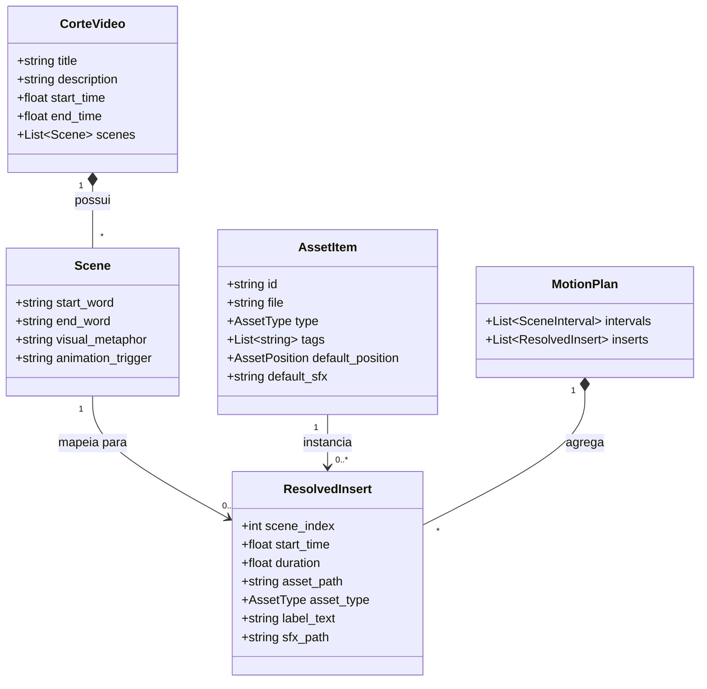

# Data Model: Inserts Animados de Motion Design

**Feature**: `021-animated-motion-inserts`  
**Date**: 2026-11-02  
**Status**: APPROVED  

---

## 1. Entidades do Catálogo de Assets (`manifest.json`)

```python
from enum import Enum
from typing import List, Optional, Tuple
from pydantic import BaseModel, Field


class AssetType(str, Enum):
    ANIMATED_VIDEO = "animated_video"  # WebM ou MOV com transparência alfa
    ICON_WITH_CARD = "icon_with_card"  # Imagem PNG/SVG que gera card procedural
    SFX = "sfx"                        # Efeito sonoro WAV/MP3 curto


class AssetPosition(str, Enum):
    UPPER_THIRD = "upper_third"    # Padrão: y = 14% a 32% (acima do orador/centro)
    MIDDLE_THIRD = "middle_third"  # y = 35% a 55% (quando orador estiver em enquadramento aberto)
    LOWER_THIRD = "lower_third"    # y = 60% a 70% (nunca > 72% para evitar legendas a 79%)


class AssetItem(BaseModel):
    """Representa um elemento catalogado no manifest de assets."""
    id: str = Field(..., description="Identificador único (ex: 'chart_growth')")
    file: str = Field(..., description="Caminho relativo a partir de /assets (ex: 'animations/business/chart_up.webm')")
    type: AssetType = Field(..., description="Tipo do elemento (animated_video, icon_with_card, sfx)")
    tags: List[str] = Field(default_factory=list, description="Lista de palavras-chave normalizadas para match com metáforas")
    default_position: AssetPosition = Field(default=AssetPosition.UPPER_THIRD, description="Posicionamento vertical seguro recomendado")
    default_sfx: Optional[str] = Field(default=None, description="Caminho relativo do SFX padrão associado (opcional)")
    max_duration: Optional[float] = Field(default=3.0, description="Duração máxima de exibição do insert em segundos")


class AssetManifest(BaseModel):
    """Estrutura raiz do arquivo assets/manifest.json."""
    version: str = Field(default="1.0.0", description="Versão do schema do catálogo")
    assets: List[AssetItem] = Field(default_factory=list, description="Lista de assets disponíveis")
```

---

## 2. Entidades do Motor de Composição em Execução

```python
from dataclasses import dataclass
from typing import Optional, Tuple


@dataclass
class EasingProfile:
    """Perfil de aceleração matemática para animação de inserts."""
    overshoot_factor: float = 1.70158   # Fator de elasticidade da curva ease_out_back
    pop_duration: float = 0.30          # Tempo de entrada elástica em segundos
    fade_duration: float = 0.25         # Tempo de saída com fade-out em segundos
    float_amplitude: float = 4.0        # Amplitude em pixels da micro-flutuação senoidal
    float_frequency: float = 0.8        # Frequência da flutuação em Hz


@dataclass
class ResolvedInsert:
    """Plano de execução do insert vinculado a uma cena específica do corte."""
    scene_index: int
    start_time: float                   # Tempo de início absoluto no corte (em segundos)
    duration: float                     # Duração de exibição do insert (em segundos)
    asset_path: Optional[str]           # Caminho absoluto para o arquivo de asset (ou None se procedural puro)
    asset_type: AssetType               # Tipo do asset a ser renderizado
    label_text: str                     # Texto descritivo / metáfora para exibição no card
    target_width: int                   # Largura do insert (sempre par)
    target_height: int                  # Altura do insert (sempre par)
    center_x_ratio: float               # Posição horizontal centralizada (padrão 0.5)
    center_y_ratio: float               # Posição vertical segura (padrão 0.20 a 0.28)
    sfx_path: Optional[str] = None      # Caminho absoluto para o áudio de efeito (ou None)
    easing: EasingProfile = EasingProfile()
```

---

## 3. Entidades da Ferramenta de Validação (`asset_tool`)

```python
@dataclass
class AssetValidationResult:
    """Relatório técnico da validação de um asset individual."""
    file_path: str
    valid: bool
    asset_type: str
    has_alpha: bool
    dimensions: Optional[Tuple[int, int]] = None
    duration: Optional[float] = None
    errors: List[str] = None
    warnings: List[str] = None

    def __post_init__(self):
        if self.errors is None:
            self.errors = []
        if self.warnings is None:
            self.warnings = []
```

---

## 4. Relação com as Entidades Existentes


