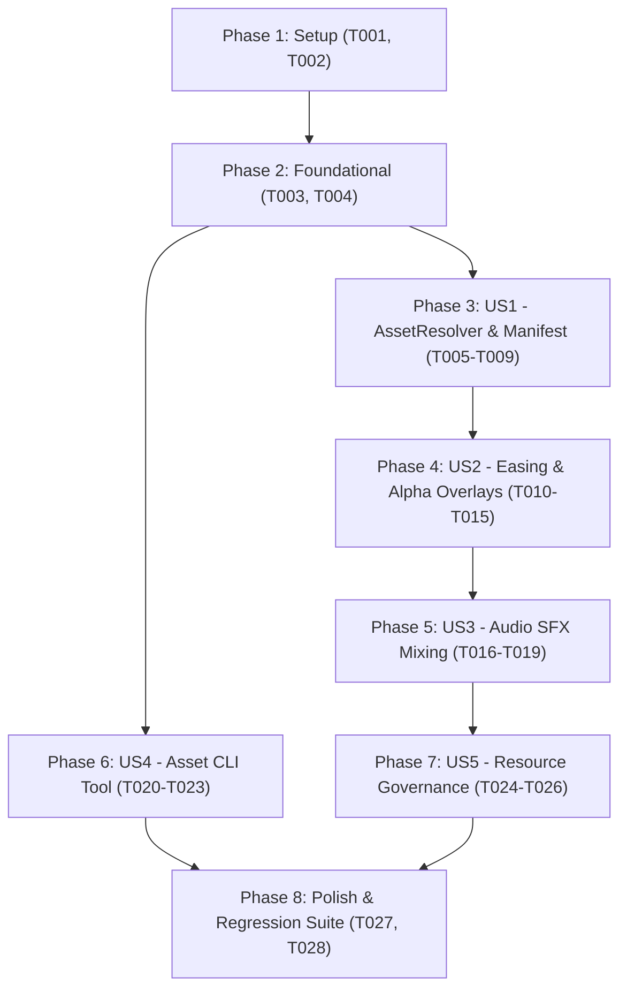

# Tasks: Inserts Animados de Motion Design (Pipeline Híbrido)

**Input**: Design documents from `/specs/021-animated-motion-inserts/`  
**Prerequisites**: plan.md (required), spec.md (required for user stories), research.md, data-model.md, contracts/  

**Tests**: Testes são incluídos explicitamente conforme especificado em spec.md (SC-006, SC-007) e plan.md.  

**Organization**: Tarefas organizadas por User Story para permitir implementação e testes independentes de cada história.

## Format: `[ID] [P?] [Story] Description`

- **[P]**: Pode rodar em paralelo (arquivos distintos, sem dependências mútuas)
- **[Story]**: A qual User Story a tarefa pertence (ex.: US1, US2, US3, US4, US5)
- Inclui caminhos exatos dos arquivos

## Path Conventions

- **Código-fonte**: `src/clipper/video/`, `src/clipper/tools/`, `src/clipper/core/`
- **Catálogo de Assets**: `assets/`
- **Testes**: `tests/`
- Afeta `src/clipper/video/asset_resolver.py`, `src/clipper/video/motion_engine.py`, `src/clipper/video/editor.py`, `src/clipper/tools/asset_tool.py`, `assets/manifest.json`, `tests/test_asset_resolver.py`, `tests/test_asset_tool.py`, `tests/test_motion_inserts.py`

---

## Phase 1: Setup (Shared Infrastructure & Starter Kit)

**Purpose**: Criação da estrutura de diretórios em `assets/`, schemas Pydantic de metadados e fixtures iniciais.

- [x] T001 Criar a estrutura inicial de diretórios para o catálogo de assets em `assets/animations/`, `assets/icons/`, `assets/sfx/` com arquivo `assets/manifest.json` inicial
- [x] T002 [P] Implementar schemas Pydantic `AssetType`, `AssetPosition`, `AssetItem` e `AssetManifest` em `src/clipper/core/schemas.py`

---

## Phase 2: Foundational (Blocking Prerequisites)

**Purpose**: Estrutura das dataclasses de execução e infraestrutura compartilhada de fixtures de teste.

**⚠️ CRITICAL**: Nenhuma história de usuário pode iniciar sem esta fundação

- [x] T003 Implementar dataclasses `EasingProfile`, `ResolvedInsert` e `AssetValidationResult` em `src/clipper/video/asset_resolver.py`
- [x] T004 [P] Criar fixtures e mocks de assets para testes unitários em `tests/test_asset_resolver.py`

**Checkpoint**: Fundação pronta - tarefas das histórias de usuário podem prosseguir

---

## Phase 3: User Story 1 - Catálogo de Assets Estruturado e Resolução Semântica (Priority: P1) 🎯 MVP

**Goal**: Implementar `AssetResolver` para carregar `assets/manifest.json` e resolver semânticamente a `visual_metaphor` da cena para o asset correspondente ou fallback para card procedural.

**Independent Test**: Executar `AssetResolver` com metáforas conhecidas, sinônimos, termos desconhecidos e sem metáfora, verificando a geração de `ResolvedInsert` com os caminhos e coordenadas corretas.

### Tests for User Story 1
- [x] T005 [P] [US1] Criar testes unitários para carregamento de `manifest.json`, validação de tags e degradação graciosa em caso de arquivo ausente em `tests/test_asset_resolver.py`
- [x] T006 [P] [US1] Criar testes unitários para o algoritmo de match semântico (match exato, match por tag, match parcial e fallback procedural) em `tests/test_asset_resolver.py`

### Implementation for User Story 1
- [x] T007 [US1] Implementar a classe `AssetResolver` com método de inicialização e leitura segura do `manifest.json` em `src/clipper/video/asset_resolver.py`
- [x] T008 [US1] Implementar o método `resolve_insert_for_scene(scene, scene_index, start_time, duration, visual_identity)` em `src/clipper/video/asset_resolver.py` com cálculo de zona segura
- [x] T009 [US1] Executar testes da User Story 1 via `PYTHONPATH=src venv/bin/python -m unittest tests/test_asset_resolver.py`

**Checkpoint**: User Story 1 100% funcional e testável de forma independente

---

## Phase 4: User Story 2 - Composição de Inserts com Curvas de Easing e Transparência Alfa (Priority: P2)

**Goal**: Implementar a renderização de clipes transparentes (WebM com VP9 alpha) e cards procedurais com curvas matemáticas de *easing* (*ease-out-back* pop-in, micro-flutuação e fade-out), compondo-os sobre os cortes em `cut_and_format_video`.

**Independent Test**: Renderizar corte de teste com insert WebM transparente e insert procedural, verificando que as animações entram com escala elástica, dimensões estritamente pares e respeitam a zona segura acima das legendas.

### Tests for User Story 2
- [ ] T010 [P] [US2] Criar testes unitários para as funções matemáticas de easing (`ease_out_back`, `sine_float`, `smooth_fade`) e garantia de dimensões pares em `tests/test_motion_inserts.py`
- [ ] T011 [P] [US2] Criar testes de sobreposição visual para clipes WebM transparentes e cards Pillow dinâmicos em `tests/test_motion_inserts.py`

### Implementation for User Story 2
- [ ] T012 [US2] Implementar funções de easing e renderização de cards procedurais com cantos arredondados e tipografia Liberation em `src/clipper/video/motion_engine.py`
- [ ] T013 [US2] Implementar `create_animated_insert_clip(resolved_insert, video_size, visual_identity)` em `src/clipper/video/motion_engine.py` com suporte a WebM com canal alfa
- [ ] T014 [US2] Integrar a resolução e sobreposição de inserts no fluxo de renderização de `cut_and_format_video` em `src/clipper/video/editor.py`
- [ ] T015 [US2] Executar testes da User Story 2 via `PYTHONPATH=src venv/bin/python -m unittest tests/test_motion_inserts.py`

**Checkpoint**: User Story 2 100% funcional com animação fluida e transparência alfa

---

## Phase 5: User Story 3 - Sincronização Não-Destrutiva de Efeitos Sonoros (SFX) (Priority: P3)

**Goal**: Mixar efeitos sonoros sutis (`pop.wav`, `whoosh.wav`) no timestamp exato de entrada de cada insert visual, preservando a faixa original de voz do corte.

**Independent Test**: Renderizar corte com inserts e verificar que a faixa de áudio final contém o áudio original mixado com os SFX no segundo correto e com volume equilibrado (-14 dB).

### Tests for User Story 3
- [ ] T016 [P] [US3] Criar testes unitários para `mix_audio_sfx` validando posicionamento temporal (`set_start`), atenuação de ganho e resiliência a arquivos ausentes em `tests/test_motion_inserts.py`

### Implementation for User Story 3
- [ ] T017 [US3] Implementar função `mix_audio_sfx(original_audio, inserts)` em `src/clipper/video/motion_engine.py` utilizando `CompositeAudioClip`
- [ ] T018 [US3] Conectar `mix_audio_sfx` à exportação final do vídeo em `cut_and_format_video` em `src/clipper/video/editor.py`
- [ ] T019 [US3] Executar testes da User Story 3 via `PYTHONPATH=src venv/bin/python -m unittest tests/test_motion_inserts.py`

**Checkpoint**: User Story 3 100% funcional com sincronização áudio-visual

---

## Phase 6: User Story 4 - Ferramenta Auxiliar de Validação e Indexação de Assets (Priority: P3)

**Goal**: Criar a ferramenta CLI `clipper.tools.asset_tool` para validar canais alfa, paridade dimensional H.264, duração de áudio e sincronizar novos arquivos com `assets/manifest.json`.

**Independent Test**: Executar a CLI em terminal validando uma pasta contendo assets válidos e arquivos intencionalmente defeituosos (dimensão ímpar, sem alfa), verificando o diagnóstico gerado e a saída com código de erro correto.

### Tests for User Story 4
- [ ] T020 [P] [US4] Criar testes unitários para a CLI `asset_tool` cobrindo inspeção de WebM com alfa, dimensões pares, PNG RGBA, áudio WAV e sincronização de manifest em `tests/test_asset_tool.py`

### Implementation for User Story 4
- [ ] T021 [US4] Implementar motor de inspeção técnica de mídia (decodificação, alfa, dimensões, duração) em `src/clipper/tools/asset_tool.py`
- [ ] T022 [US4] Implementar comandos CLI `validate` e `sync-manifest` com saída formatada e código de saída em `src/clipper/tools/asset_tool.py`
- [ ] T023 [US4] Executar testes da User Story 4 via `PYTHONPATH=src venv/bin/python -m unittest tests/test_asset_tool.py`

**Checkpoint**: User Story 4 100% funcional como ferramenta de apoio

---

## Phase 7: User Story 5 - Governança de Recursos e Fallback Resiliente (Priority: P4)

**Goal**: Garantir que o pipeline com inserts animados e áudio mixado desaloca todos os clips intermediários (`.close()`, `del`, `gc.collect()`), mantém o consumo de pico de RAM < 2 GB e executa `release_cuda_memory(cut_id=...)` incondicionalmente no perfil CUDA ao final de cada corte.

**Independent Test**: Renderizar corte de teste com múltiplos inserts e verificar que `.close()` é chamado em todas as instâncias de `VideoClip`/`AudioClip` e que `release_cuda_memory()` é disparado no bloco `finally:`.

### Tests for User Story 5
- [ ] T024 [P] [US5] Criar testes em `tests/test_motion_inserts.py` e `tests/test_editor.py` validando fechamento de clips de insert, mixagem de áudio e flush de VRAM em bloco `finally:`

### Implementation for User Story 5
- [ ] T025 [US5] Assegurar fechamento de todos os clips de insert e áudio em blocos `try...finally` dentro de `cut_and_format_video` em `src/clipper/video/editor.py`
- [ ] T026 [US5] Executar testes da User Story 5 via `PYTHONPATH=src venv/bin/python -m unittest tests/test_motion_inserts.py tests/test_editor.py`

**Checkpoint**: User Story 5 100% validada quanto ao gerenciamento de recursos

---

## Phase 8: Polish & Regression Suite

**Purpose**: Verificação completa de regressão em toda a base de testes e sincronização de documentação

- [ ] T027 Executar suíte completa de testes de regressão do projeto (`PYTHONPATH=src venv/bin/python -m unittest discover tests/ -p "test_*.py"`)
- [ ] T028 Sincronizar documentação e regras operacionais em `README.md`, `AGENTS.md` e `GEMINI.md` refletindo os inserts animados e a ferramenta auxiliar de assets

---

## Dependencies & Completion Order

### Parallel Execution Opportunities
- **US1 & US4**: A ferramenta CLI de assets (`Phase 6`) pode ser desenvolvida em paralelo com o `AssetResolver` (`Phase 3`), pois ambas dependem apenas da `Phase 2`.
- **Testes Unitários**: Todas as tarefas marcadas com `[P]` (`T002`, `T004`, `T005`, `T006`, `T010`, `T011`, `T016`, `T020`, `T024`) podem ser escritas de forma independente antes ou em paralelo com a implementação dos respectivos módulos.
